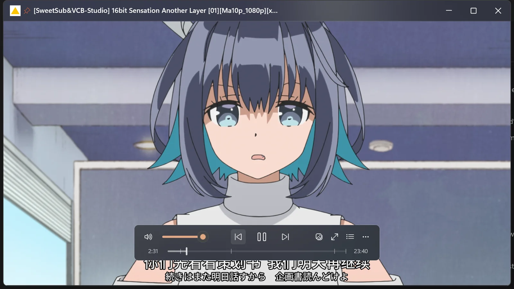
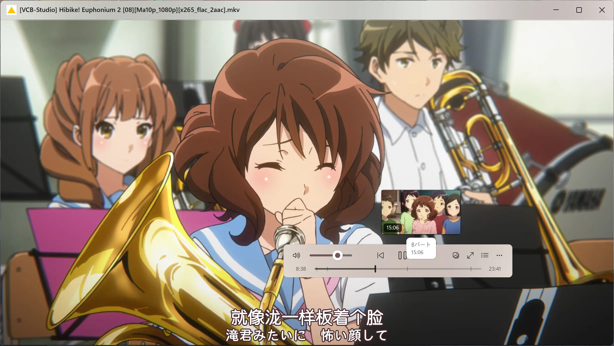
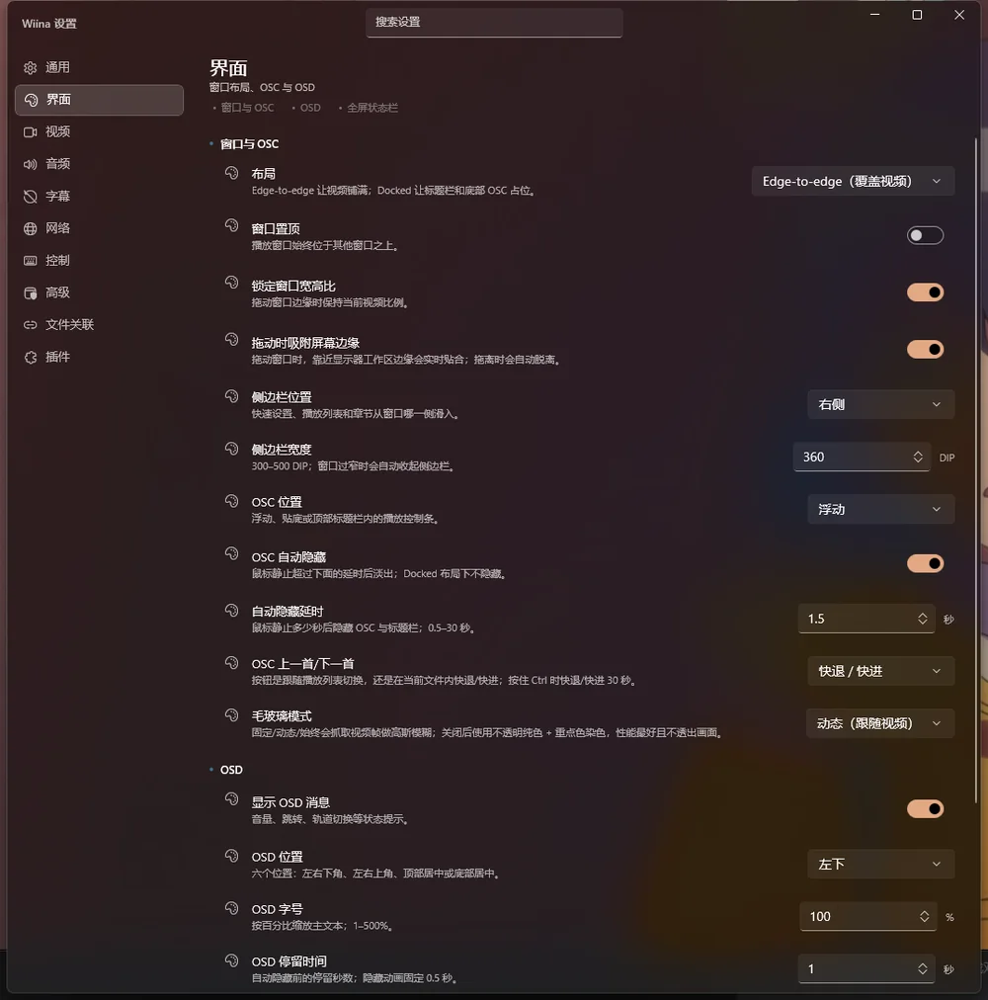
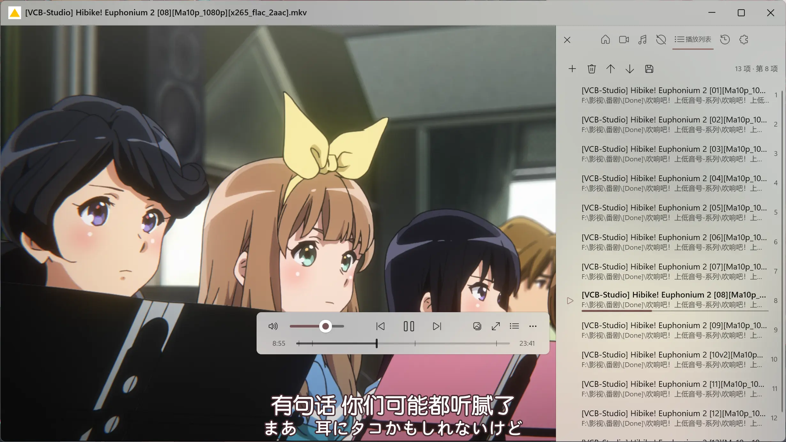
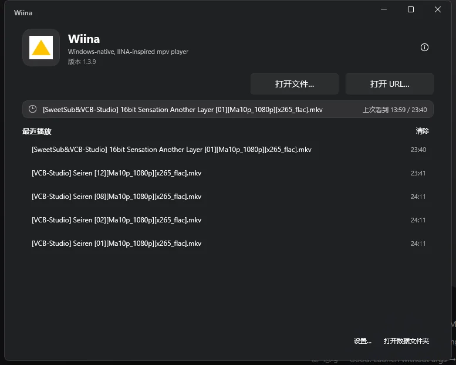
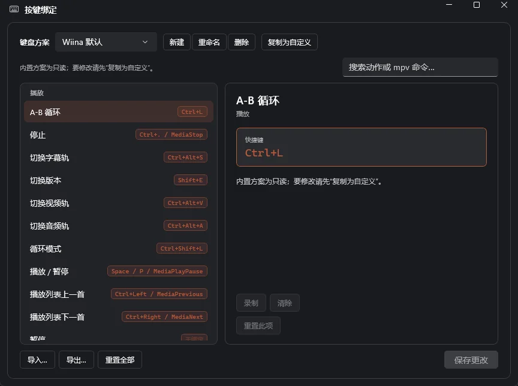
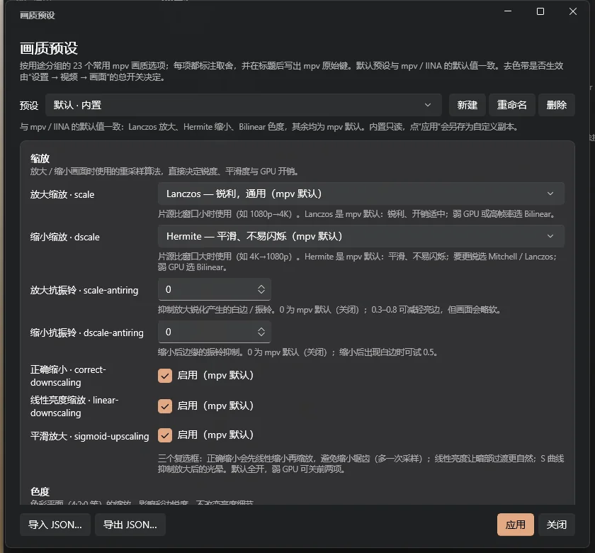
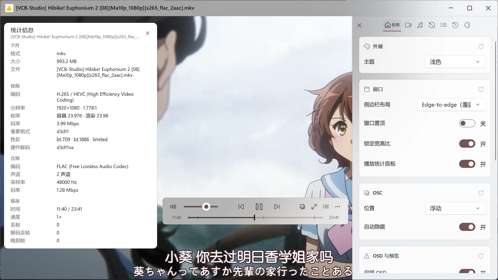

# Wiina

**把 IINA 的体验，带到 Windows。**
Windows 原生播放器 · [WinUI 3](https://learn.microsoft.com/windows/apps/winui/winui3/) + [libmpv](https://mpv.io/) · C# / .NET 10

[官网（GitHub Pages）](https://rarespecies233.github.io/wiina/) · [下载最新版](https://github.com/RareSpecies233/wiina/releases/latest) · [文档地图](#文档地图) · [更新日志](docs/release/notes.md)

[](https://github.com/RareSpecies233/wiina/releases/latest)
[](LICENSE)
[](#下载与安装)
[](tests/Wiina.Core.Tests)
[](https://learn.microsoft.com/windows/apps/winui/winui3/)



Wiina 是一个 **WinUI 3 原生**的桌面播放器，播放内核交给 **libmpv**。它不复刻 AppKit，而是把
[IINA](https://iina.io/) 的窗口层级、浮动 OSC、侧栏快速设置、OSD、小窗与状态机，按 Windows 11 Fluent
规范重新实现：Segoe UI Variable、Fluent Icons、Mica 与亚克力、圆角、深浅主题与 High Contrast。

**安装包约 100 MB，自带 .NET 运行时、Windows App Runtime、libmpv 与解码能力。** 不依赖系统解码器，
不用另装插件，也没有“先配置半小时”的前置工作——装完就能播，第一次打开就是硬件解码。

> 不是网页套壳，也不是 mpv 换皮。视频走 mpv 的 `d3d11` 合成，界面是真正的 XAML；源码全部公开。

---

## 为什么是 Wiina

| 你习惯的痛点 | Wiina 的做法 |
| --- | --- |
| **IINA 只在 macOS** | 把它的交互模型（浮动 OSC、侧栏快速设置、OSD、模式状态机）在 Windows 上重做，并适配鼠标/键盘/触控板 |
| **mpv 很强，但太“素”** | 保留 mpv 的解码、滤镜、字幕与画质能力，补上完整桌面 UI：设置搜索、快捷键编辑器、播放列表、章节、统计面板 |
| **播放器界面停在十年前** | 原生 WinUI 3、高 DPI、深/浅/高对比度、减少动态、Mica 与圆角，全部跟随系统与 Windows 重点色 |
| **字幕/预览总差一点** | 同集外挂字幕全部入列、assfonts 优先、双字幕；缩略图预生成 + 磁盘缓存 + 即时预览 |
| **小窗/画中画割裂** | 无边框 PiP、快捷键与主窗一致、贴边吸附、小窗期间自动挂起毛玻璃抓帧 |

---

## 十一个你会用到的细节

### 1 · 开箱即用：自带运行库与硬解

约 100 MB 的安装包已经包含运行所需的一切：.NET 10、Windows App Runtime、libmpv 0.41。GPU 支持时
默认走 `d3d11va` 硬件解码，不支持时自动回退软解；不需要额外下载解码器或 Codec Pack。

- 便携 zip 与安装包双形态；安装版支持就地升级，卸载时清理关联并可选保留配置。
- 首次运行可能触发 SmartScreen（未签名），点「更多信息 → 仍要运行」即可，发布页附 SHA-256。

### 2 · 浮动 OSC：把画面还给视频



OSC 不再横贯整个画面底部，而是浮在视频上，可拖动、可停靠、可记忆位置。鼠标静止一段时间自动隐去；
真正离开窗口或失焦立即收起；5 px 内的手抖不会唤醒它。

- 播放/暂停、音量、进度、截图、全屏、画中画一屏可达。
- 悬停进度条显示精确缩略图；左侧时间与右侧时长分行排布，不挡字幕。

### 3 · WinUI 3 亚克力：像原生应用，而不是套壳



标题栏、OSC、侧栏、OSD 与设置窗口共用一套 Fluent 设计令牌：Mica/亚克力、圆角、Fluent 动画、
深浅色跟随系统，并用 Windows 重点色给控件着色。切换主题即时生效，不需要重启。

- 11 页设置全部支持键盘操作、High Contrast 与屏幕阅读器名称。
- 减少动态、系统主题、重点色变化都会实时响应。

### 4 · 毛玻璃与纯色：两套质感，各取所需



OSC 与 OSD 支持「固定 / 动态 / 始终 / 纯色」四档。毛玻璃把视频帧模糊后垫在控件下面；纯色档只有
一块不透明底色 + 重点色染色，零抓帧、零 GPU 模糊，低配设备最省。

- 在 WinUI 3 里把 mpv 画面模糊成控件背景，目前仅此一家。
- 进入 PiP / 迷你模式会自动挂起抓帧，回到主窗再恢复。

### 5 · 记忆播放：看到哪里，下次就从哪里继续



欢迎窗口直接列出最近播放与上次进度，点一下回到原位。不用再为了记住时间点把文件发到微信传输助手。

- 每个文件独立记录播放位置；最近播放可一键续播或清除。
- 打开文件 / 打开 URL 就在手边。

### 6 · 设置与搜索：不用到处找选项

11 个设置页按使用场景分组，每项都有说明与即时预览。顶部搜索支持中英文与关键词：输「字幕」就能
直接定位字号、颜色、边框；输「缓存」「硬解」同样直达。

- 改完即时生效，不需要重启播放器。
- 数字输入防抖保存，关窗也不会丢。

### 7 · 快捷键：IINA 的习惯，mpv 的底子



内置 Wiina（基于 IINA 习惯，79 个常用键位）与 mpv 两套方案，也可以自己录制。编辑器支持搜索、
分类、冲突检查、导入导出与重置；菜单里的快捷键提示会跟着你的配置变化。

### 8 · 画质：默认就很好，想调也调得动



默认档对齐 mpv / IINA 的原生默认值：Lanczos 放大、Hermite 缩小、Bilinear 色度。需要折腾时，
23 项 mpv 参数在图形界面里按组排好，每项都标注作用与原始键名；支持 JSON 导入导出与自定义档案。

- 缩放 / 色度 / 抖动 / 去色带 / 插帧 / 同步 / 其他分组。
- libass 字幕内核，内嵌字体与 ASS 特效正常渲染。

### 9 · 缩略图：预生成与即时预览

预生成模式下，打开文件后在后台建立全片索引；23 分钟的视频约 30 秒完成，之后悬停“指哪打哪”。
也可以切换成即时预览：只解码指针所在位置，配合 250 ms 防抖，不占磁盘与内存。

- 磁盘 LRU 缓存可调上限，重启后仍可复用。
- 低配设备可选「慢速预览模式」：单线程低优先级，不抢播放与 UI 的 CPU。

### 10 · 智能字幕与外置音轨

同集全部外挂字幕自动列出（不会混入其他集），`assfonts` 版本优先并默认选中；外置音轨一并识别。
打开即看，不用每次手动加载；已经手动选过的字幕不会被自动选择覆盖。

### 11 · 网络资源与 Windows 集成

- **打开 URL** 即可播放 http(s)、HLS 等流媒体，与本地文件共用同一套 OSC 与快捷键。
- **文件关联**：写入 Windows 默认应用，或管理员权限下一键关联常见视频/音频格式；卸载时清理干净，
  并恢复安装前的关联与配置选择。

> **路线图**：mpv 插件系统与 IINA 插件兼容层将在下一个版本见面。

---

## 截图

| 窗口播放 | 快速设置 | 播放统计 |
| --- | --- | --- |
|  |  |  |

| 设置 | 快捷键 | 画质 |
| --- | --- | --- |
|  |  |  |

---

## 下载与安装

前往 **[Releases](https://github.com/RareSpecies233/wiina/releases/latest)** 下载最新版本：

| 形态 | 文件 | 适合 |
| --- | --- | --- |
| 便携版 | `wiina-<version>-win-x64.zip` | 解压即用、不写安装信息；自带 `Uninstall Wiina.exe` 可清理注册表与配置 |
| 安装版 | `Wiina-Setup-<version>-x64.exe` | 开始菜单/卸载入口；卸载器会提权并可选保留配置 |

- **系统要求**：Windows 10 2004+（build 19041）或 Windows 11，x64；自带 .NET 与 Windows App Runtime，无需另装。
- **没有代码签名**：首次运行可能出现 SmartScreen「Windows 已保护你的电脑」，点 **更多信息 → 仍要运行**；
  详细说明与卸载残留清理见 [docs/installer.md](docs/installer.md)。
- **校验下载**：每个版本的 zip/setup 大小与 SHA-256 记录在 [验收页](docs/acceptance/README.md)，
  可用 `Get-FileHash <file> -Algorithm SHA256` 对比。

---

## 30 秒上手

| 操作 | 默认键 |
| --- | --- |
| 播放/暂停 | `Space` |
| 快进/快退 5 秒 | `→` / `←`（`Ctrl` 为 30 秒） |
| 音量 | `↑` / `↓`、滚轮 |
| 全屏 | `Enter` / 双击画面 |
| 快速设置侧栏 | `Shift+Alt+V`（视频）/ `A`（音频）/ `S`（字幕）/ `P`（播放列表） |
| 设置 | `Ctrl+,` |
| 截图 | `Ctrl+S` |
| 画中画 | `Ctrl+Shift+P` |
| 循环 / 置顶 / 静音 | `Ctrl+L` / `Ctrl+T` / `Ctrl+/` |

完整键位（含 mpv 原生动作）见 [docs/reference/iina-shortcuts.md](docs/reference/iina-shortcuts.md)；
应用内「设置 → 控制 → 快捷键」可搜索、录制、冲突检测、导入导出。

---

## 文档地图

| 想知道 | 去哪里 |
| --- | --- |
| 视频如何从 mpv 到 WinUI | [docs/architecture/0001-video-pipeline.md](docs/architecture/0001-video-pipeline.md) |
| 毛玻璃/纯色档怎么实现 | [docs/architecture/0003-acrylic.md](docs/architecture/0003-acrylic.md) · [0004-solid-chrome.md](docs/architecture/0004-solid-chrome.md) |
| IINA 交互规格 | [docs/reference/IINA-macOS-UI-复刻规格.md](docs/reference/IINA-macOS-UI-复刻规格.md) |
| 缩略图完整逻辑 | [docs/reference/thumbnails.md](docs/reference/thumbnails.md) |
| 设置页/行清单 | [docs/reference/settings-layout.md](docs/reference/settings-layout.md) |
| 快捷键与 IINA 对照 | [docs/reference/iina-shortcuts.md](docs/reference/iina-shortcuts.md) |
| 每个版本验收了什么 | [docs/acceptance/README.md](docs/acceptance/README.md) |
| 发布说明与已知问题 | [docs/release/notes.md](docs/release/notes.md) · [known-issues.md](docs/release/known-issues.md) |
| 安装、卸载、文件关联 | [docs/installer.md](docs/installer.md) · [file-associations.md](docs/file-associations.md) |
| 性能与卡顿分析 | [docs/performance.md](docs/performance.md) · [docs/reports/](docs/reports) |
| 参与开发 | [CONTRIBUTING.md](CONTRIBUTING.md) |

---

## 仓库结构

```text
src/
  Wiina.App/          WinUI 3 外壳：窗口、控件、视图、服务、Win32 互操作
  Wiina.Core/         纯逻辑：设置目录、状态机、输入/快捷键、字幕、缓存、播放策略
  Wiina.Mpv/          libmpv 绑定与播放器封装（属性、事件、截图、轨道）
  Wiina.Uninstall/    提权卸载器（单文件、无 UI 依赖）
tests/
  Wiina.Core.Tests/   xUnit：几何、吸附、OSC、快捷键、缓存、设置等
docs/
  architecture/       架构决策（视频管线、标题栏、毛玻璃、纯色档）
  acceptance/         逐版本人工验收 + 产物校验和
  reference/          IINA 规格、缩略图、设置布局、快捷键
  release/            发布说明、已知问题、发布流程
  reports/            卡顿/性能/缩略图专题报告
installer/            Inno Setup 脚本 + 简体中文语言包
resources/mpvnet/     给 mpv.net 的 wiina.conf / wiina-input.conf
scripts/              dev-build / package / release
site/                 GitHub Pages 落地页（纯静态）
tools/                libmpv 获取等开发脚本
```

---

## 构建与测试

前置：.NET 10 SDK、Windows 10 2004+；libmpv 由脚本获取（`third_party/` 不提交二进制）。

```powershell
# 首次：抓取 libmpv
pwsh -File tools/fetch-libmpv.ps1

# 构建 app（注意：不是解决方案级 -p:Platform）
dotnet build .\src\Wiina.App\Wiina.App.csproj -c Release -p:Platform=x64

# 单元测试
dotnet test .\tests\Wiina.Core.Tests\Wiina.Core.Tests.csproj -c Release

# 或使用仓库脚本（串行构建锁 + 日志）
pwsh -File scripts/dev-build.ps1 -Agent me -Test

# 打包 portable zip / 安装包
pwsh -File scripts/release.ps1 -Version 1.3.9
```

验收基线：**943 项测试通过**、Release 构建 **0 警告 / 0 错误**、便携包与安装包冒烟通过。
详见 [docs/acceptance/v1.3.9.md](docs/acceptance/v1.3.9.md)。

---

## 项目状态

- 当前版本 **v1.3.9**（2026-10-25），前置版本见 [更新日志](docs/release/notes.md)。
- 设置 **11 页 / 133 行**；本地化 **581** 个字符串键。
- 已实现：播放管线、原生标题栏、OSC/侧栏、播放列表/章节/历史、字幕、缩略图、统计面板、
  全屏/PiP/迷你、文件关联、快捷键编辑器、字幕字体、滤镜/均衡器、HDR、单实例与拖放。
- 未实现（明确跳过）：插件宿主、在线字幕、yt-dlp。相关入口保持可见但禁用并说明原因。
- 已知限制：`Always` 毛玻璃档在主窗可见时仍按 ~8 Hz 抓帧；混合 DPI 下部分悬停/吸附几何未覆盖；
  光标自动隐藏在少数 WinUI 输入栈环境仍可能失效。见 [known-issues.md](docs/release/known-issues.md)。

---

## 参与贡献

欢迎 Issue、功能建议与 PR。开始之前：

1. 读 [CONTRIBUTING.md](CONTRIBUTING.md) 与最近的 [验收记录](docs/acceptance/README.md)；
2. 改动逻辑请补 `tests/Wiina.Core.Tests` 用例；
3. 用户可见行为变化请同步 `docs/`（验收页、参考文档或发布说明）；
4. 提交前跑 `pwsh -File scripts/dev-build.ps1 -Agent <name> -Test`。

---

## 许可证与致谢

- **GPL-3.0-only**，见 [LICENSE](LICENSE) 与 [NOTICE](NOTICE)。
- 界面交互灵感来自 [IINA](https://github.com/iina/iina)（GPL-3.0）；未复制其 Swift/AppKit 源码或图像资源。
- 播放内核：[mpv](https://github.com/mpv-player/mpv) / libmpv（GPL-2.0-or-later）。
- 界面框架：WinUI 3 / Windows App SDK。
- Wiina 与 IINA、mpv 项目均无隶属关系。
