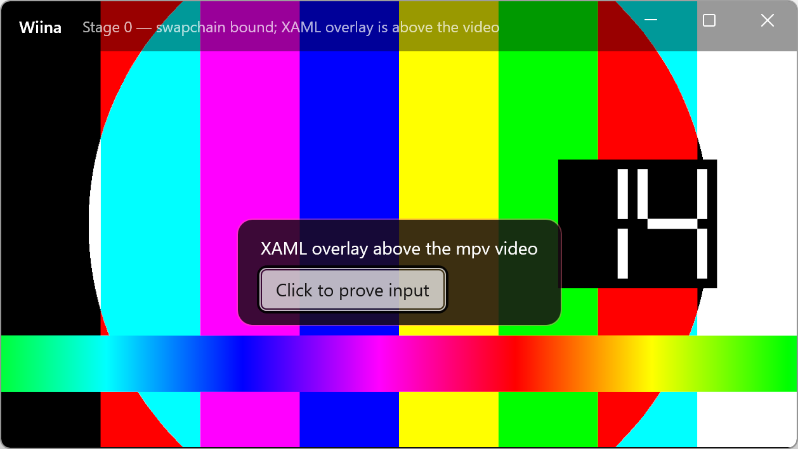
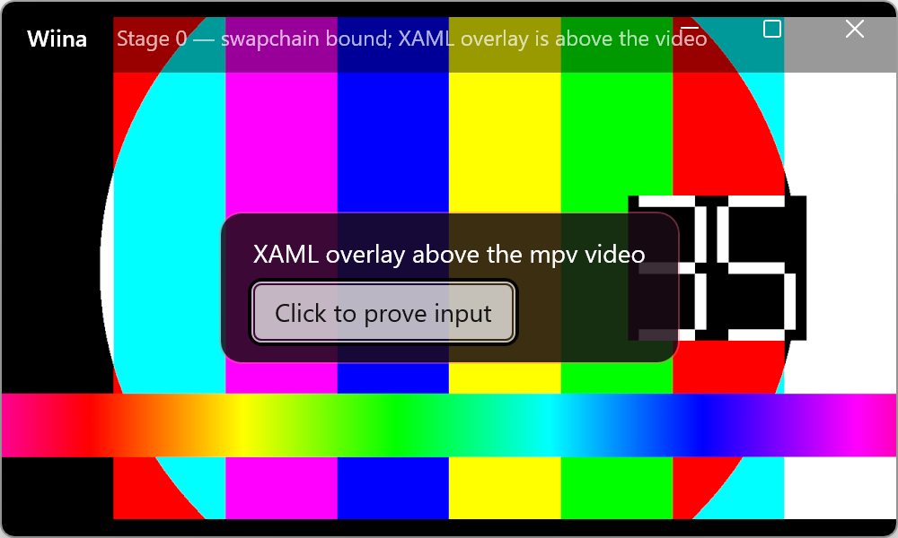
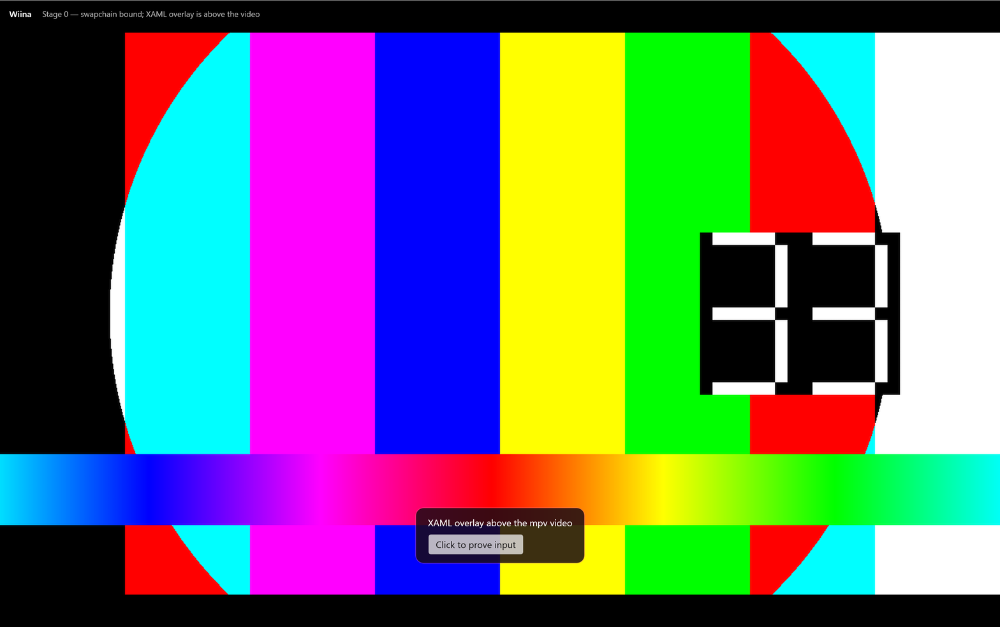

# Stage 0 — 基线与风险验证（验收包）

- **分支**：`stage/0-foundation`
- **提交**：本分支 HEAD（`docs/acceptance/stage-0.md` 随该提交）
- **日期**：2026-10-18
- **环境**：
  - Windows 11 25H2（build 26200），125% 显示缩放
  - .NET SDK 10.0.402（用户级 `%USERPROFILE%\.dotnet`）
  - Windows App SDK 2.5.1（NuGet，self-contained）
  - libmpv：`v0.41.0-1205-g01e2533f3`（shinchiro `mpv-dev-x86_64` 20261018 构建）
  - GPU：NVIDIA GeForce RTX 3070 Ti，驱动 32.0.16.1088
  - 另检测到 `OrayIddDriver` / `Microsoft Remote Display Adapter`（远程桌面虚拟显示）

## 交付范围

- `Wiina.slnx` + 三个项目：`Wiina.Core`、`Wiina.Mpv`、`Wiina.App`。
- `Wiina.Mpv`：libmpv P/Invoke、事件线程、属性观察、命令封装；`display-swapchain` 事件。
- `Wiina.App`：unpackaged WinUI 3 窗口、自定义标题栏、`SwapChainPanel` 视频层、XAML 覆盖层、F11 全屏、干净退出。
- `tools/fetch-libmpv.ps1`（固定版本 + SHA256；Stage 0 已实测）。
- CI：`.github/workflows/build.yml`（Windows + .NET 10，restore/build）。
- 文档：`NOTICE`、`LICENSE`、`docs/licensing/AUDIT.md`、ADR-0001。

## 构建与运行

```powershell
# 取 libmpv（若尚未执行）
powershell -ExecutionPolicy Bypass -File tools/fetch-libmpv.ps1

# 构建（用户级 .NET 10 时把 dotnet 换成完整路径）
dotnet build Wiina.slnx -c Debug

# 运行
.\src\Wiina.App\bin\x64\Debug\net10.0-windows10.0.26100.0\win-x64\Wiina.exe
```

> 输出是 **self-contained + WindowsAppSDKSelfContained**，目标机不需要额外安装 .NET / Windows App Runtime。
> 首次构建需要 NuGet 还原 Windows App SDK 包。

## 验收清单

| # | 项目 | 结果 | 证据 |
|---|---|---|---|
| 1 | 干净构建：`dotnet build Wiina.slnx -c Debug` | ✅ 0 warning / 0 error | 本地输出 |
| 2 | 视频在 `SwapChainPanel` 中显示 | ✅ | 下方窗口截图 |
| 3 | XAML 覆盖层在视频上方 | ✅ | 截图中的红色/半透明面板 |
| 4 | XAML 输入在视频上方可用 | ✅ 点击按钮后计数递增 | 手动验证 |
| 5 | 窗口 resize：1258×709 → 1000×600 | ✅ 视频随窗口缩放，无花屏 | 下方 resize 截图 |
| 6 | 125% DPI 下画面正确铺满 | ⚠️ 通过 XAML 1/dpi 缩放实现；驱动拒绝 `SetMatrixTransform` | 见“已知问题” |
| 7 | F11 进入全屏 / 再按退出 | ✅ 进入后全屏；退出恢复 1258×709 | 下方全屏截图 |
| 8 | 关闭窗口后进程/线程退出 | ✅ 无残留 `Wiina.exe`，无 crash 日志 | 手动验证 |
| 9 | 仓库不含 mpv 二进制 / IINA 资产 | ✅ `third_party/libmpv/`、`repo/` 均 gitignored | `git status` |
| 10 | CI 工作流已加入 | ✅ 本地构建通过；首次 Actions 运行待 push | `.github/workflows/build.yml` |

## 截图

### 窗口化（1280×720，125% DPI）



### Resize 到 1000×600



### 全屏（F11）



## 已知问题 / 偏离

1. **`IDXGISwapChain2::SetMatrixTransform` 被驱动拒绝**：在 125% DPI 下返回
   `DXGI_ERROR_INVALID_CALL (0x887A0001)`。当前改用“面板按物理像素布局 + XAML `CompositeTransform`
   1/dpi”实现铺满；画面正确，但这条 DXGI 路径在本机不可用。Stage 1 可评估其他 DPI 方案。
2. **标题栏右侧 caption 按钮区域有系统灰色底**：`ExtendsContentIntoTitleBar` + 透明按钮背景在该组合下
   未让视频透出。Stage 1 的自定义标题栏会改为自绘按钮/正确处理该区域。
3. **当前只播放 mpv `testsrc` 测试图案**：真实媒体、轨道/字幕/OSC 在后续阶段。
4. **Trace 日志写到 `%TEMP%\wiina-trace.log`**：Stage 0 临时诊断用，Stage 1 换成正式日志服务。
5. 窗口最小尺寸 / 宽高比锁定 / docked 布局等属于 Stage 1，本阶段未做。

## 许可证检查

- ✅ 未提交 `libmpv-2.dll`（`third_party/libmpv/` 已忽略）。
- ✅ 未复制 IINA Swift/AppKit 源码、`.xcassets`、SF Symbols 或图标。
- ✅ `LICENSE`（GPL-3.0）、`NOTICE`、`docs/licensing/AUDIT.md` 已就位。
- ✅ 新增依赖：`Microsoft.WindowsAppSDK`（MIT）、`Microsoft.Windows.SDK.BuildTools`（Microsoft 可再分发）。

## 下一步（Stage 1）

- 主窗口静态骨架：自定义标题栏（caption 区域、pin/去黑边）、edge-to-edge/docked、最小尺寸、宽高比锁定、主题/材质。
- 图标映射测试页、资源字典、空 OSC/侧栏壳。
- 修复本阶段的两个已知视觉问题。

> 请验收：如果通过，我会把 `stage/0-foundation` 分支推到 `origin` 并给出 PR 描述；通过后再进入 Stage 1。
