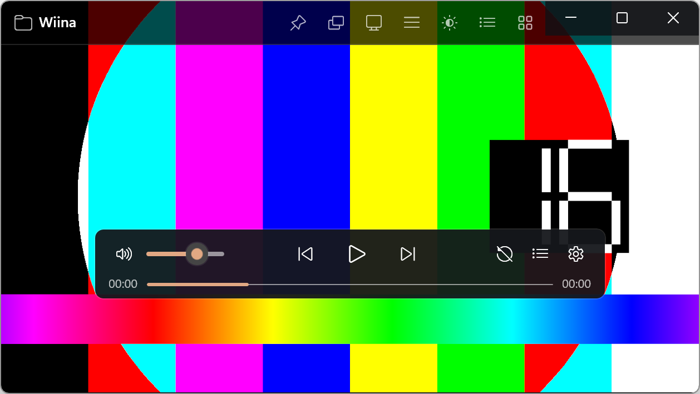
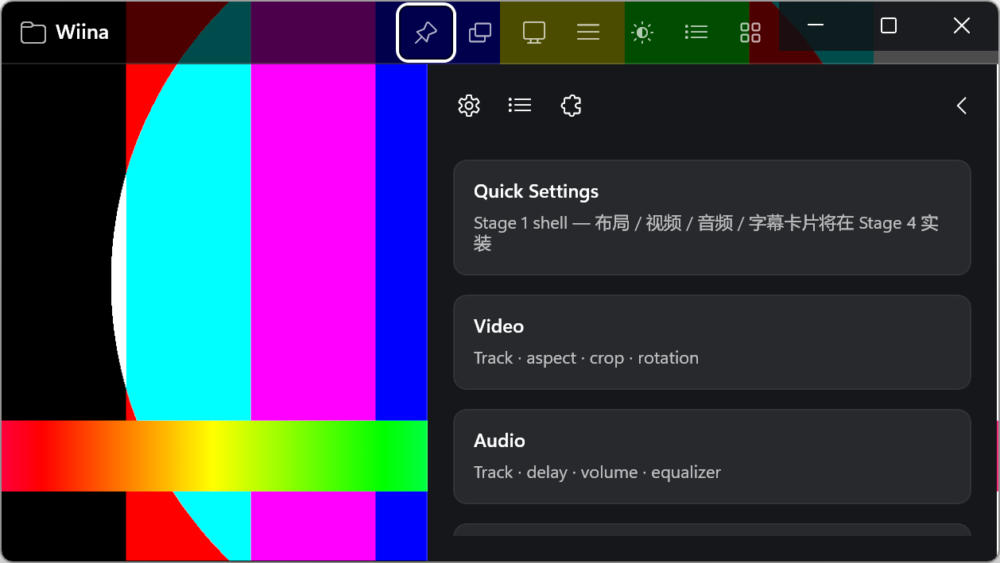
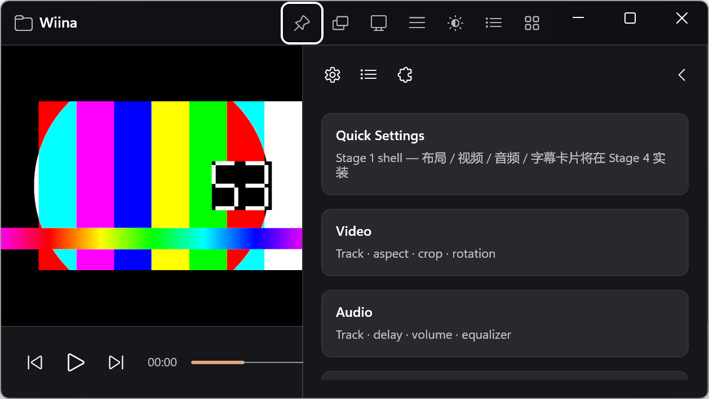
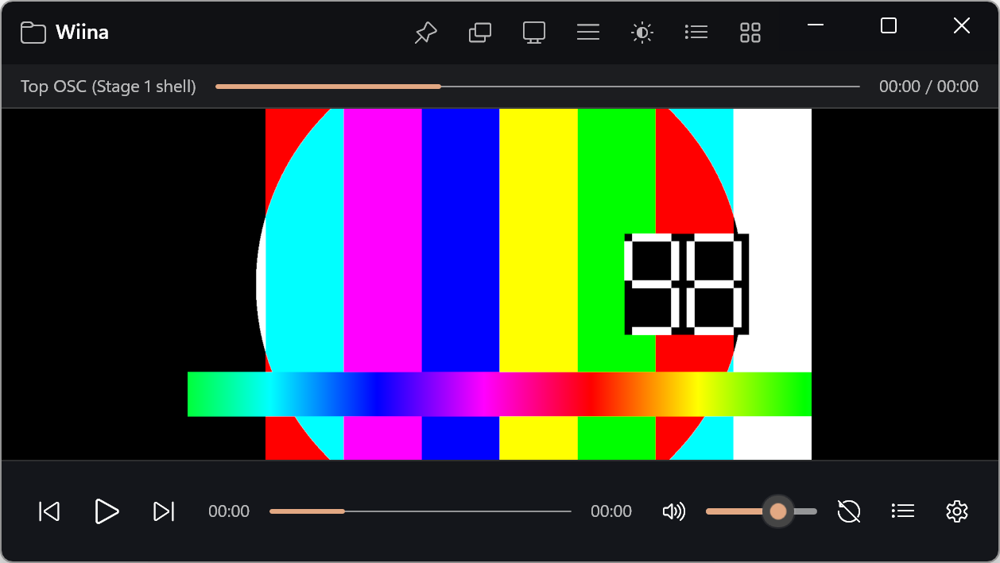
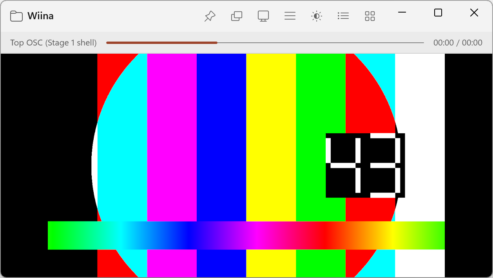
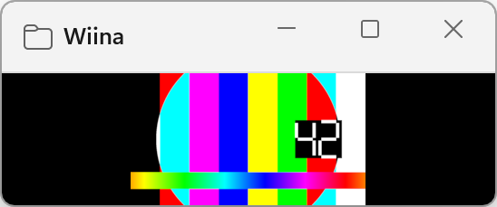

# Stage 1 — 主窗口静态骨架（验收包）

- **分支**：`stage/1-shell`
- **提交**：本分支 HEAD
- **日期**：2026-10-18
- **环境**：Windows 11 25H2 26200；显示缩放约 200%（高 DPI）；.NET SDK 10.0.402；
  Windows App SDK 2.5.1；libmpv 0.41.0-1205-g01e2533f3；RTX 3070 Ti。

## 交付范围

- **资源字典**：`Themes/Tokens.xaml`（深浅色、尺寸、字体、图标字体）、`Themes/Controls.xaml`
  （标题栏按钮、OSC 按钮、面板/卡片、标题/说明文本样式）。
- **自定义标题栏** `Controls/TitleBarView`：应用图标、标题、pin / layout / OSC / sidebar /
  theme / icons / window 按钮；右侧为系统 caption buttons；窄窗口自动隐藏工具按钮；顶部 OSC 行。
- **主窗口布局**：edge-to-edge ↔ docked 两种结构；视频 `SwapChainPanel` 在后，标题栏/OSC/侧栏叠加；
  视频按 1/dpi 的 XAML 变换铺满；F11 / Esc 全屏。
- **OSC 三个壳**：浮动（460×64，圆角 8）、底部（全宽 64）、顶部（标题栏内 28 行），仅静态布局。
- **侧栏壳**：360 宽、标签栏、关闭按钮、快速设置/视频/音频/字幕卡片占位。
- **设置持久化**：`%LOCALAPPDATA%\Wiina\settings.json`（主题、布局、OSC 位置、窗口位置/尺寸、置顶、宽高比锁）。
- **Win32 互操作**：`WM_GETMINMAXINFO` 最小尺寸；`WM_SIZING` 宽高比锁。
- **辅助 UI**：窗口尺寸菜单（0.5×/1×/2×/适合屏幕）、Segoe Fluent Icons 映射对话框。
- **快捷键（Stage 1 调试用）**：`Ctrl+Shift+B` 侧栏、`Ctrl+Shift+L` 布局、`Ctrl+Shift+O` OSC、
  `Ctrl+Shift+T` 主题。

## 验收清单

| # | 项目 | 结果 | 证据 |
|---|---|---|---|
| 1 | `dotnet build Wiina.slnx -c Debug` | ✅ 0 warning / 0 error | 本地输出 |
| 2 | 默认深色、edge-to-edge、浮动 OSC、无侧栏 | ✅ | 窗口化截图 |
| 3 | 自定义标题栏 + 系统 caption buttons | ✅ 右侧灰底已消除 | 窗口化/浅色截图 |
| 4 | edge-to-edge ↔ docked | ✅ 视频让位、底部 OSC 出现 | docked 截图 |
| 5 | OSC 三位置 | ✅ 浮动/底部/顶部壳 | top OSC 截图 |
| 6 | 侧栏壳（360、标签、卡片、关闭） | ✅ | 侧栏截图 |
| 7 | 深/浅/跟随系统主题 | ✅ | 浅色截图 |
| 8 | 最小尺寸 | ✅ 互操作已生效；高 DPI 下实际约 548×229 物理（≈274×115 DIP） | min-size 截图 |
| 9 | 宽高比锁 | ⚠️ 已接入 `WM_SIZING`；仅交互式拖动触发，程序化 `SetWindowPos` 不经过它 | 代码 |
| 10 | 设置持久化 | ✅ 重启恢复 docked/主题/窗口几何 | `settings.json` |
| 11 | 干净关闭 | ✅ 无残留进程、无 crash 日志 | 手动验证 |
| 12 | 许可证 | ✅ 无新增不兼容依赖；无 IINA/SF Symbols 资产 | 审计 |

## 截图

### 默认窗口化（edge-to-edge + 浮动 OSC）



### 侧栏壳（edge-to-edge）



### Docked（标题栏 + 视频 + 底部 OSC）



### 顶部 OSC 壳



### 浅色主题



### 最小尺寸（高 DPI）



## 已知问题 / 偏离

1. **Docked + 侧栏时底部 OSC 片段未压缩**：右侧工具组被侧栏遮住；Stage 4 按片段优先级压缩/隐藏。
2. **高 DPI 下的 compact 阈值**：窗口 DIP 宽度 < 520 时隐藏 OSC/工具栏；本机 200% 缩放下
   1258 物理像素 ≈ 629 DIP，所以正常窗口是非 compact。Stage 2 会按实际可用宽度做更细的压缩。
3. **宽高比锁只对交互式拖动生效**：`WM_SIZING` 不覆盖程序化 `SetWindowPos`，这是 Win32 语义，不是缺陷。
4. **顶部 OSC 只是壳**：没有时间/进度/控件绑定；Stage 2 实装。
5. **图标为占位映射**：Segoe Fluent Icons 的实际字形/语义在 Stage 8 逐个核对。
6. **侧栏为不透明面板**：Stage 1 优先可读性；Acrylic/半透明在 Stage 4/8 调。
7. **调试快捷键**（Ctrl+Shift+B/L/O/T）保留到 Stage 4，之后并入正式键位表。

## 运行

```powershell
powershell -ExecutionPolicy Bypass -File tools/fetch-libmpv.ps1
dotnet build Wiina.slnx -c Debug
.\src\Wiina.App\bin\x64\Debug\net10.0-windows10.0.26100.0\win-x64\Wiina.exe
```

## 下一步（Stage 2）

- OSC 状态机、2.5s 自动隐藏、鼠标进入/离开、拖动/吸附/持久化。
- 进度条/时间/音量真实控件；章节线、缓冲段、A-B 旋钮、时间预览。
- 窄窗口片段压缩规则；浮动/底部/顶部三种位置的可见性优先级。
