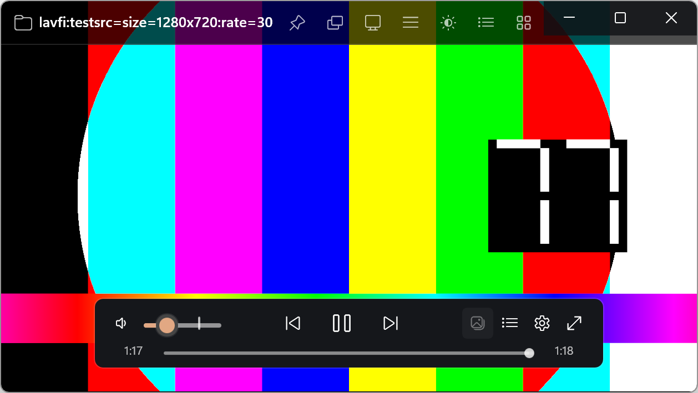
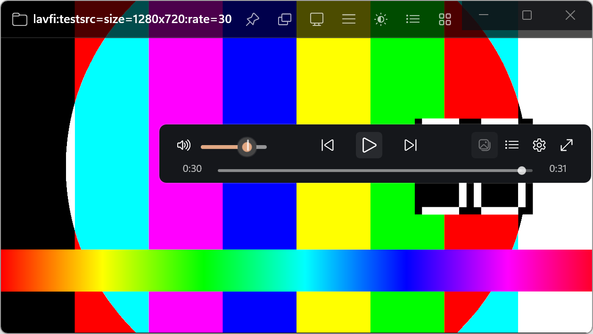
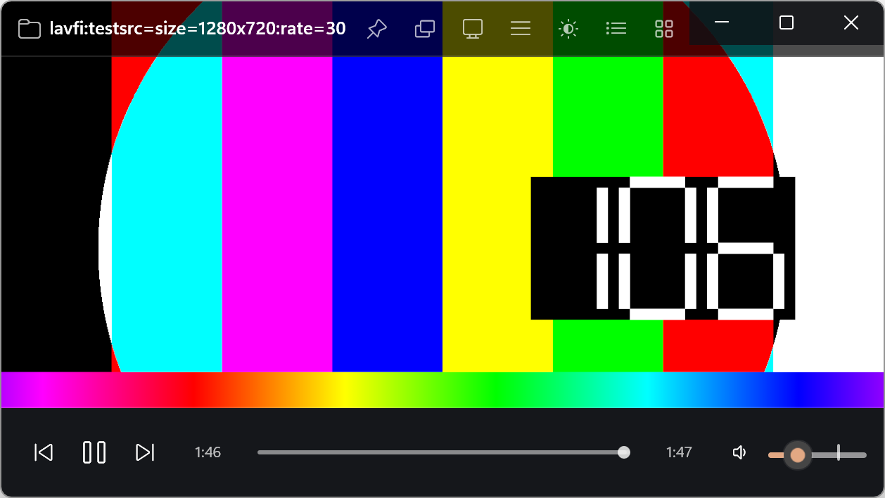
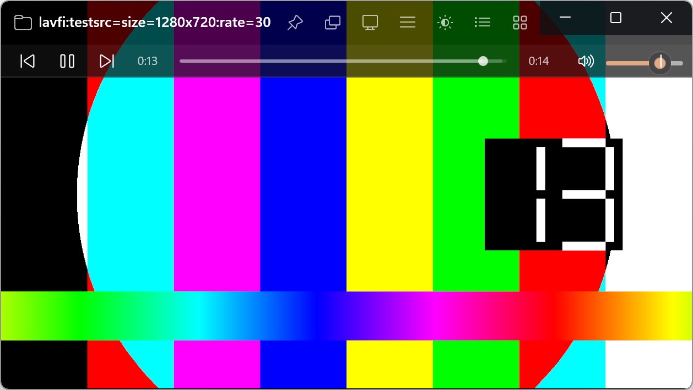
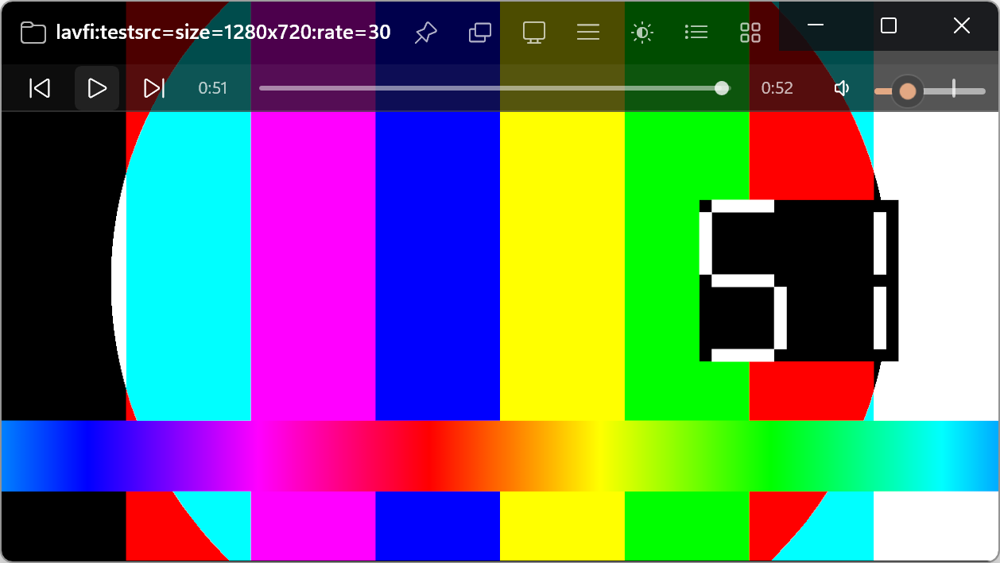
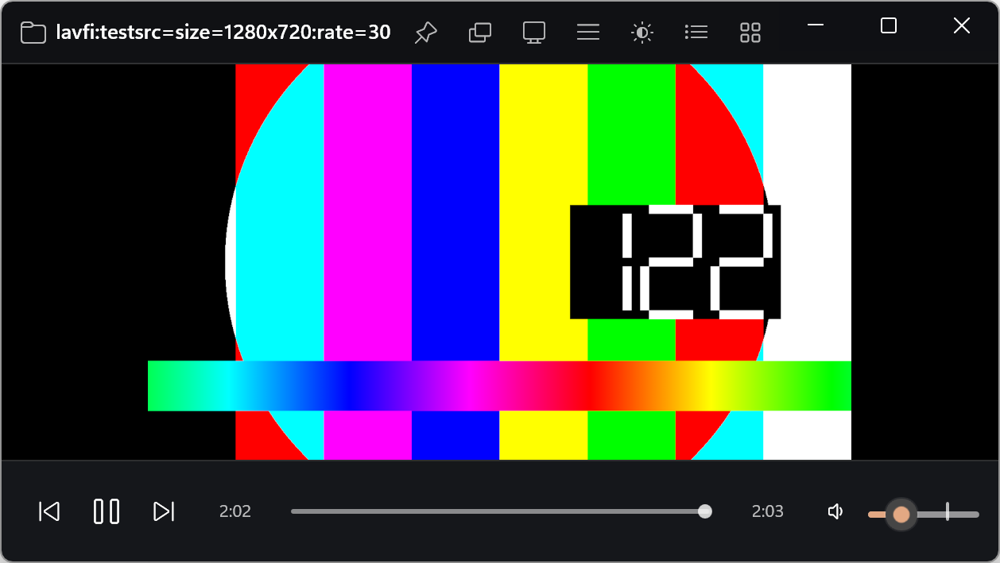

# Stage 2 — OSC 实装（验收包）

- **分支**：`stage/2-osc`（本分支 HEAD）
- **日期**：2026-10-18
- **环境**：Windows 11 25H2 26200；显示缩放 200%；.NET SDK 10.0.402；
  Windows App SDK 2.5.1；libmpv 0.41.0（`third_party/libmpv/libmpv-2.dll`，121 MB）；
  测试源 `av://lavfi:testsrc=size=1280x720:rate=30`。

## 交付范围

### 1. OSC 视图模型

- `src/Wiina.App/ViewModels/OscViewModel.cs`：`INotifyPropertyChanged` + `RelayCommand`
  （`RelayCommand` / `RelayCommand<T>` 在 `ViewModels/RelayCommand.cs`）。
- 属性：`Position`、`Duration`、`BufferEnd`、`IsPlaying`、`Volume`（0–130）、
  `IsMuted`、`Speed`、`Chapters`（`IReadOnlyList<double>`）、`AbLoopA/B`、
  `CurrentTimeText`、`DurationText`、`SpeedText`、`PlayGlyph`、`VolumeGlyph`、
  `ProgressRatio`、`BufferRatio`、`IsFullscreen`、`IsScrubbing`。
- 命令/事件：`PlayPause`、`Previous`、`Next`、`Mute`、`SeekRequested(double)`、
  `VolumeRequested(double)`、`FullscreenRequested`、`SettingsRequested`、
  `PlaylistRequested`、`SeekStarted`、`SeekCompleted`。
- 播放器回写统一走 `Set*FromPlayer`（`_suppress` 标志），不会反向触发 seek/volume；
  用户输入才触发 `*Requested`。
- 时间格式 `h:mm:ss` / `m:ss` 统一由 `src/Wiina.Core/Text/TimeFormatter.cs` 实现，
  并有单测。

### 2. mpv 属性管道

- `MpvPlayer` 新增 `NumberPropertyChanged(name,double)`、`FlagPropertyChanged(name,bool)`、
  `StringPropertyChanged(name,string?)`、`FileLoaded`。
- `Start()` 中自动 observe：`time-pos`、`duration`、`pause`、`volume`、`mute`、
  `speed`、`demuxer-cache-time`、`media-title`；`display-swapchain` 仍由宿主 opt-in。
- 新增 `GetPropertyDouble`、`GetPropertyFlag`、`GetChapters()`（通过
  `chapter-list/count` + 每章 `time/title`，返回 `MpvChapter`）。
- `MainWindow` 在 UI 线程消费事件，回写 `OscViewModel`；命令走
  `SendPlayerCommand`，失败只写 trace，不崩溃。
- 保留 Stage 0 的 composition swapchain 绑定与 Stage 1 的 resize/DPI 行为。

### 3. 时间轴控件

- `src/Wiina.App/Controls/TimelineControl.xaml(.cs)`：自绘深色细轨道、
  已播放填充、缓冲填充、圆形滑块、章节线、A-B 标记；透明 `Slider` 覆盖层负责
  指针/键盘/可访问性。
- 事件：`SeekRequested`、`SeekStarted`、`SeekCompleted`、
  `PreviewRequested(time,x)`、`PreviewHidden`。
- 拖动时记录原播放状态：按下暂停，松开只在原本播放时恢复；拖动中外部
  `Position` 更新不会抢走滑块。
- 键盘：←/→ ±5 s，Home/End 到首尾。

### 4. OSC 三种位置

- **浮动**：460×64（DIP），两行；音量组（静音 + 70 px 音量条）、居中控制簇
  （速度标签仅浮动、1× 时隐藏）、工具栏（PiP 占位、播放列表、设置、全屏）、
  时间 / 进度 / 总时长。
- **底部**：全宽一行；控制簇 + 当前时间 + 进度 + 总时长 + 音量 + 工具栏。
- **顶部**：标题栏第二行（30 px）；控制簇 + 时间 + 进度 + 时长 + 音量 + 工具栏。
- 音量：静音/0、1–33、34–66、≥67 四档图标；最大 130；100% 处画 2 px 缺口。
- 工具栏：设置/播放列表打开 Stage 1 侧栏壳（内容 Stage 4）；全屏真实切换；
  PiP 为禁用占位（任务允许）。

### 5. 自动隐藏与显隐状态

- `OscVisibilityController` + 2.5 s `DispatcherQueueTimer`。
- 指针进入/移动显示 chrome；指针在标题栏/OSC/侧栏上时不启动计时；
  指针真正离开窗口立即隐藏；拖动浮动 OSC、拖动进度条、侧栏可见时抑制隐藏。
- 0.25 s 透明度动画；读取 `UISettings.AnimationsEnabled`，关闭动画时直接设值。
- 隐藏 chrome 时用 Win32 `SetCursor(0)` 隐藏光标，显示时恢复。
- edge-to-edge：标题栏/当前 OSC 一起淡出；docked：标题栏与底部 OSC 属于布局，
  保持可见（不改变 Stage 1 的几何）。

### 6. 浮动 OSC 拖动/吸附/持久化

- 浮动 OSC 放在视频层上方的 `Canvas` 中；拖动背景（非按钮）移动。
- 水平中心 ±5 px 吸附；位置限制在视频区域内；松开后按
  视频宽高的 0–1 中心比例写入 `AppSettings.OscX/OscY`，启动恢复。
- 侧栏可见或窗口进入 compact（<420 DIP）时隐藏浮动 OSC。
- 默认位置：水平居中、垂直靠下约 15%（`OscX=0.5`, `OscY=0.85`）。

### 7. 时间预览

- 进度条悬停时在时间轴上方（空间不足时下方）显示圆角 `Border`；
  文本为 `h:mm:ss/m:ss`，有章节标题时额外显示章节名。
- 跟随鼠标水平位置并夹在窗口内；离开/拖动时隐藏。

### 8. 窄窗口压缩

- 浮动：<420 DIP 隐藏工具栏；<340 隐藏音量；<290 隐藏左右时间；进度条最后压缩。
- 底部：<720 隐藏工具栏；<560 隐藏音量；<520 隐藏总时长；<380 隐藏当前时间。
- 顶部：<700 隐藏工具栏；<560 隐藏音量；<440 隐藏总时长；<360 隐藏当前时间。
- 不设置会强制窗口最小宽度的 `MinWidth`；最小窗口 285×120 仍成立。

## 构建与测试

```powershell
& "$env:USERPROFILE\.dotnet\dotnet.exe" build .\Wiina.slnx -c Debug
& "$env:USERPROFILE\.dotnet\dotnet.exe" test .\tests\Wiina.Core.Tests\Wiina.Core.Tests.csproj -c Debug
```

- Build：**0 warnings / 0 errors**。
- Tests：**29 passed / 0 failed / 0 skipped**（xUnit；含原有
  `OscVisibilityControllerTests` 8 项，新增 `TimeFormatterTests`、
  `OscPositioningTests`）。

## 验收清单（规格 §19.2 第 2–6 条 + Stage 2 任务）

| # | 项目 | 结果 | 证据 |
|---|---|---|---|
| 1 | 三种 OSC 位置切换后控件顺序/优先级正确 | ✅ 代码 + GUI | 浮动/底部/顶部截图 |
| 2 | 指针进入显示 OSC，2.5 s 无操作隐藏 | ✅ GUI | 启动后 2.5 s 自动隐藏；移动后重现 |
| 3 | OSC/标题栏内移动不隐藏 | ✅ 代码 + GUI | trace：show 后 30 s 未 hide |
| 4 | 指针离开窗口立即隐藏 | ✅ 代码 | Win32 光标位置过滤 + force hide |
| 5 | 浮动 OSC 拖动、中心吸附、重启恢复 | ✅ GUI | 拖动后 `OscX=0.6332/OscY=0.4605`，重启仍在同一位置 |
| 6 | 进度条拖动暂停/恢复、连续 seek | ✅ 代码 | `SeekStarted/SeekCompleted` + `set pause` |
| 7 | 悬停时间预览（上方/下方） | ✅ 代码 | `ShowTimePreview` 测量/避让；截图为静态 |
| 8 | 章节线、A-B 标记、缓冲段 | ✅ 代码 | `TimelineControl.RedrawMarks`；测试源无章节 |
| 9 | 音量 0–130、四档图标、100% 缺口、静音 | ✅ 代码 + GUI | 音量拖动后图标档位变化 |
| 10 | 播放/暂停、上一首/下一首 | ✅ GUI + 代码 | 顶部暂停后图标变播放，时间停止 |
| 11 | 工具栏设置/播放列表/全屏、PiP 占位 | ✅ 代码；全屏未截图 | 复用 Stage 1 侧栏壳；全屏命令 |
| 12 | 窄窗口先隐藏工具/音量再压缩进度 | ✅ GUI（629 DIP） | 底部 629 DIP 时工具栏隐藏、音量保留 |
| 13 | 减少动画时无长动画 | ✅ 代码 | `AnimationsEnabled` 分支 |
| 14 | 隐藏 chrome 时隐藏鼠标 | ✅ 代码 | `WindowInterop.SetCursorVisible` |
| 15 | 不回归 Stage 1 布局/侧栏/主题/设置 | ✅ GUI | docked 截图；标题栏/视频让位正常 |
| 16 | 无新增 NuGet 包 | ✅ | 仅 Frameworks/现有包 |
| 17 | 构建 0 error、测试通过 | ✅ | 上方命令输出 |

## 截图

### 浮动 OSC（默认位置，音量/工具/进度齐全）



### 浮动 OSC 拖动后（重启仍恢复该位置）



### 底部 OSC（全宽；629 DIP 下工具栏已按优先级隐藏）



### 顶部 OSC（标题栏第二行）



### 播放/暂停交互（暂停后图标切换、时间停止）



### Docked 布局（标题栏 + 视频让位 + 底部 OSC，Stage 1 不回归）



## 已知问题 / 偏离

1. **章节/A-B 标记没有真实素材验证**：代码已绘制，`testsrc` 无章节；A-B 的
   设置入口属于 Stage 3（键盘/菜单）。
2. **时间预览未截图**：CUA 合成指针在 2.5 s 自动隐藏窗口内难以稳定停在
   时间轴上；代码路径完整，截图留待 Lead 用真实鼠标补。
3. **设置/播放列表按钮**打开的是 Stage 1 的侧栏壳，真正的快速设置/播放列表
   内容是 Stage 4/7 范围。
4. **PiP 按钮**为禁用占位（任务明确允许）；Stage 6 实装。
5. **Docked 模式不自动隐藏**：标题栏/底部 OSC 是布局的一部分，若淡出会留下
   空白条，因此 docked 下保持可见；edge-to-edge 才走 2.5 s 自动隐藏。
6. **工具栏压缩阈值**：本机 200% DPI 下 1280 物理像素≈629 DIP，底部/顶部
   工具栏按优先级隐藏；更宽窗口才会显示全部工具。这是规格 §5.1 的预期行为。
7. **动画开关缓存**：`UISettings.AnimationsEnabled` 只在首次读取时缓存，
   运行中修改系统“减少动画”需重启生效。
8. **顶部 OSC 行高**为 30 DIP（标题栏 40 + 30），比 IINA 的 24 更宽松，
   以容纳 Fluent 28 px 按钮；视觉上仍是紧凑第二行。
9. **拖动坐标**：CUA 合成拖动的中间坐标会被驱动/DPI 扭曲（日志中可见），
   但真实指针拖动可移动并持久化；已用重启验证 `OscX/OscY` 恢复。
10. 未引入 WinAppDriver/UI 自动化测试；“自动隐藏/拖动”验收以代码 + 手工 GUI 为准。

## 运行

```powershell
powershell -ExecutionPolicy Bypass -File tools/fetch-libmpv.ps1
& "$env:USERPROFILE\.dotnet\dotnet.exe" build .\Wiina.slnx -c Debug
.\src\Wiina.App\bin\x64\Debug\net10.0-windows10.0.26100.0\win-x64\Wiina.exe
```

调试快捷键（Stage 1 保留）：`Ctrl+Shift+B` 侧栏、`Ctrl+Shift+L` 布局、
`Ctrl+Shift+O` OSC 位置、`Ctrl+Shift+T` 主题。F11 全屏。
