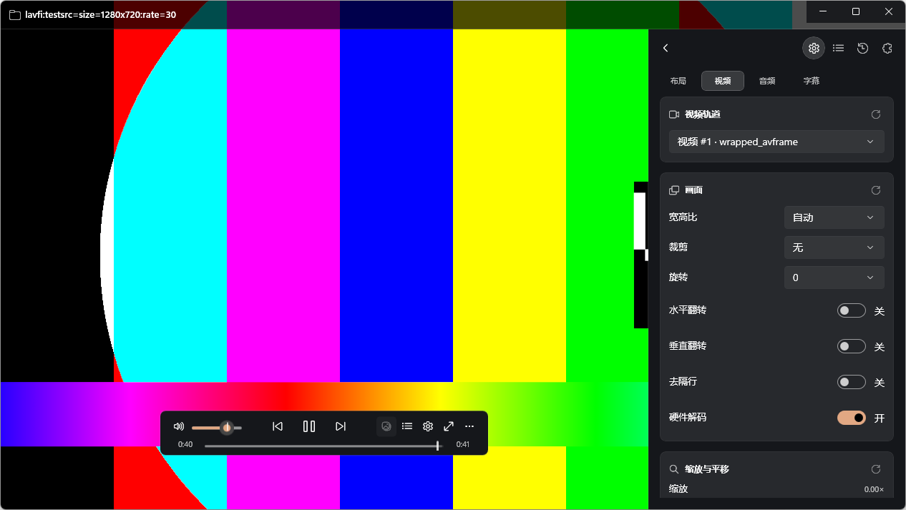

# Stage 4 — 侧边栏与快速设置（验收包）

- **分支**：`stage/4-sidebar`（本分支 HEAD）
- **日期**：2026-10-18
- **环境**：Windows 11 25H2 26200；.NET SDK 10.0.402；
  Windows App SDK 2.5.1；libmpv 0.41.0（`third_party/libmpv/libmpv-2.dll`）。
- **测试媒体**（`%TEMP%` 之外未提交）：`av://lavfi:testsrc=size=640x360:rate=30`。

## 1. 交付范围

### 1.1 侧边栏容器

- 真实容器替换 Stage 1 的静态壳：左右两个 `SidebarHost`、真正的标签栏、
  关闭按钮、4 DIP 内边缘宽度拖拽、内容宿主。
- 宽度默认 360 DIP，拖拽范围 300–500 且不超过窗口 80%
  （`SidebarState.ClampWidth`，窗口过窄时 300 下限优先；<420 DIP 时整体隐藏）。
- 显示/隐藏动画 0.24 s（`SidebarState.AnimationSeconds`）；系统/应用关闭动画时
  改为 240 ms 纯淡入，应用开关关闭时 0 时长（手动 `DispatcherQueueTimer` 插值，
  不依赖被系统抑制的 Storyboard 依赖动画）。
- 规则：同一侧同一时间一个类型；点击当前标签关闭；同侧不同类型原地替换；
  另一侧可用不同类型；同一类型只会出现在一侧（再次显示会移动到新侧）。
  规则由 Core `SidebarState` 实现并有单测。
- 侧边栏顶部：标题栏可见时为 40 DIP，标题栏自动隐藏/全屏时为 0
  （`SetTitleBarVisible` → `UpdateSidebarMargins`）。
- Edge-to-edge 覆盖视频；Docked 收缩视频区域与底部 OSC（`UpdateDockedInsets`）；
  Edge-to-edge 下单击视频关闭侧栏（点击被消费，不再触发 OSC 单击）。
- 侧栏可见时抑制 OSC 自动隐藏（`OscVisibilityController.IsSuppressed`），
  浮动 OSC 可用区域收缩到侧栏内边缘，避免被遮挡。
- 快捷键：`Ctrl+Shift+B` 播放列表侧栏；新增 `Ctrl+Shift+S` 快速设置侧栏
  （Core `PlayerActions.SidebarSettings`）；OSC 工具栏、标题栏与 `⋯` 菜单亦可打开。
- 持久化到 `AppSettings`：`SidebarSide`、`SidebarWidth`、`SidebarType`、
  `QuickSettingsPage`。

### 1.2 快速设置（4 页）

- 页签：布局 / 视频 / 音频 / 字幕；每页为可滚动卡片栈，卡片使用
  `CardBorderStyle`（8 圆角、1px 边框、半透明填充），标题行含 16px 图标、
  标题与右对齐重置按钮。
- **布局**：主题（跟随系统/深色/浅色）、启用动画、Edge-to-edge/Docked、
  窗口置顶、锁定宽高比、OSC 位置、OSC 2.5 s 自动隐藏、侧栏默认一侧与宽度。
- **视频**：视频轨道（自动/关闭/具体轨道）、宽高比、裁剪、旋转 0/90/180/270、
  水平/垂直翻转、去隔行、硬件解码、缩放/水平平移/垂直平移（滑杆 + 数值）。
- **音频**：音频轨道、音量（滑杆 + 百分比）、最大音量 NumberBox、静音、
  音频延迟 ±10 s、音频输出设备（从 libmpv `audio-device-list` 节点缓存枚举，
  实测 3 个设备，含 “Autoselect device”）。
- **字幕**：主/次字幕轨道、显示开关、加载字幕按钮、延迟 ±30 s、垂直位置 0–150、
  缩放 0.5–2.0、字号 8–120、颜色预设、边框 0–10；ASS/图像字幕显示样式警告。
- 所有控件即时通过 `MpvPlayer.TrySetPropertyString` / `CommandAsync` 生效；
  音量/静音/切轨等写入 `AppSettings` 并在重启后重新应用。
- 无媒体时禁用轨道/画面/字幕控件并显示提示；音量/静音与布局设置保持可用；
  禁用的控件有明确原因（无媒体、图像字幕）。
- 每张卡片的重置按钮恢复该卡默认值并同步两侧侧栏视图。

### 1.3 播放列表 / 章节

- 播放列表：使用 `MpvPlayer` 的 `playlist` 缓存（无 UI 线程 NODE 读取），
  当前项高亮（播放图标 + 半粗体 + 行内进度条）、双击/回车播放、
  多选移除、上移/下移、添加文件、保存 `.m3u`、右键菜单
  （播放/上移/下移/移除/复制路径）、`ListView` 内建拖拽重排 →
  `playlist-move`。
- 章节：时间 + 标题、当前章节高亮、双击/回车跳转（`set chapter`）。
- 两个列表在 `track-list`/`chapter-list`/`playlist`/`playlist-pos`/
  `chapter` 事件与 `FileLoaded` 后刷新。

### 1.4 其它

- `MpvPlayer` 新增 `audio-device-list` 节点解析、`audio-device` 字符串观察、
  `GetAudioDevices()` 缓存与 `AudioDeviceListChanged` 事件。
- 新增 Core 纯逻辑：`SidebarState`（槽位/规则/宽度/动画模式/停靠内缩）、
  `QuickSettings`（选项表、音量/延迟/字幕样式 clamp、旋转、裁剪尺寸、滤镜串、
  颜色规范化）。
- 新增 Core 测试 84 项（SidebarStateTests、QuickSettingsTests）。

## 2. 构建与测试

```powershell
& "$env:USERPROFILE\.dotnet\dotnet.exe" build .\Wiina.slnx -c Debug
& "$env:USERPROFILE\.dotnet\dotnet.exe" test .\tests\Wiina.Core.Tests\Wiina.Core.Tests.csproj -c Debug
```

结果（本分支最终一次）：

- Build：**0 warnings / 0 errors**。
- Tests：**187 passed / 0 failed / 0 skipped**（原有 103 + 新增 84）。

## 3. 验收清单

| # | 项目 | 结果 | 证据/备注 |
|---|---|---|---|
| 1 | 左右槽位、标签栏、关闭按钮 | ✅ 代码 + 桌面 | 截图见 §4；`SidebarHost` |
| 2 | 同标签关闭 / 同侧替换 / 另一侧不同类型 / 类型唯一 | ✅ 单测 | `SidebarStateTests` 17 项 |
| 3 | 宽度 360、拖拽 300–500、≤80% | ✅ 桌面拖拽 + 单测 | 360 → 417 并写入 `settings.json`；clamp 单测 |
| 4 | 0.24 s 滑入/滑出、减少动画淡入 | ✅ 代码 | 手动 15 ms 插值；开关在布局页 |
| 5 | 侧栏顶部随标题栏显示/隐藏 | ✅ 桌面 | 截图标题栏下 40 DIP；`SetTitleBarVisible` 联动 |
| 6 | Edge-to-edge 覆盖 / Docked 收缩视频 | ✅ 桌面 | Docked 截图视频与底部 OSC 让位 |
| 7 | Edge-to-edge 单击视频关闭侧栏 | ✅ 桌面 trace | `video tapped` → `sidebar state … any=False` |
| 8 | 侧栏抑制 OSC 自动隐藏 | ✅ 桌面 | 侧栏打开 3+ 分钟 OSC 保持可见 |
| 9 | `Ctrl+Shift+B` / `Ctrl+Shift+S` | ✅ 桌面 | SendKeys；trace 键盘 + sidebar state |
| 10 | 持久化 side/width/type/page | ✅ 桌面 | `%LOCALAPPDATA%\Wiina\settings.json` |
| 11 | 布局页控件与即时生效 | ✅ 桌面 | 主题/动画/布局/置顶/OSC/侧栏卡片 |
| 12 | 视频页轨道/宽高比/裁剪/旋转/翻转/去隔行/硬解/缩放平移 | ✅ 代码 + 桌面渲染 | 轨道列表来自缓存；空媒体禁用 |
| 13 | 音频页轨道/音量/最大音量/延迟/设备/静音 | ✅ 桌面 | 设备 3 个；`Autoselect device` |
| 14 | 字幕页轨道/显隐/延迟/位置/缩放/字号/颜色/边框/加载 | ✅ 桌面渲染 | 无字幕媒体时轨道为“关闭”；警告逻辑代码 |
| 15 | 卡片重置按钮 | ✅ 代码 | 每卡恢复默认并同步两侧 |
| 16 | 播放列表当前项/双击/移除/上下移/添加/保存/右键/拖拽 | ✅ 代码 + 桌面列表 | 双击/拖拽未用真实第二项逐项验收（见 §5） |
| 17 | 章节列表/当前高亮/双击跳转 | ✅ 代码；⚠️ 无章节媒体 | 列表空态截图；Stage 3 无章节片源 |
| 18 | 无 UI 线程 `mpv_get_property(NODE)` | ✅ 代码 | 只用 `GetTracks/GetChapters/GetPlaylist/GetAudioDevices` 缓存 |
| 19 | 不回归 Stage 1–3 | ✅ 构建/测试 + 桌面 | 标题栏/OSC/播放/键盘/历史代码保留 |
| 20 | 无新增 NuGet / 无提交媒体或二进制 | ✅ | 只用现有 WinAppSDK/xUnit |

## 4. 桌面冒烟（GUI）

运行：

```powershell
.\src\Wiina.App\bin\x64\Debug\net10.0-windows10.0.26100.0\win-x64\Wiina.exe `
  "av://lavfi:testsrc=size=640x360:rate=30"
```

通过 CUA/`SendKeys` 在真实桌面验证：

- `Ctrl+Shift+S` 从右侧滑入快速设置侧栏（顶部在标题栏下，宽度 360/417 DIP）。
- 标签栏：快速设置 / 播放列表 / 章节 / 插件 均可点击切换；
  再次点击当前“快速设置”标签关闭（trace `any=False`）。
- 快速设置页签：布局、视频、音频、字幕四页均渲染；宽高比/裁剪显示
  “自动/无”，旋转 0；视频轨道显示 “视频 #1 · wrapped_avframe”。
- 音频页：音量 100%、最大 130、延迟 0.0 s；设备下拉
  “Autoselect device”，提示“共 3 个设备”。
- 字幕页：主/次字幕“关闭”、显示开、延迟 0.0 s、位置 100、缩放 1.00×、
  字号 55、边框 3。
- 布局页切到 **Docked**：视频区收缩到左侧，底部 OSC 只占视频宽度；
  `Ctrl+Shift+L` 切回 Edge-to-edge。
- Edge-to-edge 下单击视频：侧栏关闭，trace 记录 `video tapped` 与状态 `any=False`。
- 拖拽内边缘：宽度 360 → 417 DIP，释放后 `settings.json` 写入 417；
  再点击侧栏内边缘外的视频不会触发拖拽。
- 插件页：占位说明 + 禁用的“安装插件…（Stage 9）”，并写明禁用原因。
- 关闭窗口后 `Get-Process Wiina` 为空。

`settings.json` 验证（桌面冒烟后）：`SidebarWidth=417`、`SidebarType=Settings`、
`QuickSettingsPage=Subtitles`、`Layout=Docked`。

## 5. 已知问题 / 偏差

1. **动画计时未用录屏测量**：实现为 0.24 s 手动插值（淡入路径同一时长）；
   系统关闭动画时走淡入，应用关闭动画时 0 时长。截图无法证明时长，需 Lead 录屏确认。
2. **播放列表拖拽重排未真实验收**：使用 `ListView` 内建重排 + `playlist-move`，
   代码路径已接；本机只有一个 lavfi 条目，未构造第二条目做拖拽。
   上移/下移按钮与右键菜单同样未逐项点击（Stage 3 菜单版已验证命令）。
3. **章节跳转无真实片源**：本机没有带章节的 MKV/MP4；列表空态与
   `set chapter` 代码已接，需 Lead 用真实章节文件补测。
4. **播放列表行元数据**：mpv `playlist` 节点只有 filename/current/playing，
   没有时长/分辨率，因此行内只显示标题、路径、序号与进度条；
   规格中的 `playlistShowMetadata`（时长/分辨率/编码）留待后续用额外查询实现。
5. **拖拽重排与刷新竞态**：拖拽后先本地重排，再发 `playlist-move`，
   mpv 事件回来会重建列表；极端情况下有一次列表回跳。
6. **裁剪实现**：当前 libmpv composition 构建拒绝 `video-crop=0x0/no`，
   改用 `vf crop=W:H`（与翻转共用 `vf` 链）。重置时写空 `vf`。
   若 Stage 8 引入滤镜链编辑，需要合并/保留用户滤镜。
7. **硬件解码切换**：`hwdec` 在运行时写入，通常对下一个文件生效；
   当前文件可能需重新打开。写入失败会记录 trace，不阻塞 UI。
8. **音频设备切换**：写 `audio-device` 后由 mpv 重建音频输出，短暂静音；
   设备列表来自 `audio-device-list` 节点缓存。
9. **字幕样式**：只实现字号/颜色/边框宽度；字体族、边框颜色、阴影、
   ASS 覆盖样式未做（Stage 8）。图像字幕（PGS/VobSub）禁用样式控件并显示警告。
10. **插件页是显式占位**：按任务保留入口，安装按钮禁用并写明 Stage 9；
    没有假的插件列表或可点击死控件。
11. **均衡器未做**：PLAN 允许先占位/只读；侧栏未放均衡器卡片，避免死 UI，
    完整 EQ 属于 Stage 8。
12. **Leading 侧视觉未逐项验证**：Windows 没有红绿灯，leading 标签栏未留
    96 px 空白；结构与 trailing 对称（关闭按钮在右、标签在左）。规则层单测覆盖。
13. **窗口 <420 DIP**：侧栏整体隐藏（沿用 Stage 1 紧凑规则）；宽度下限 300
    优先于 80% 规则（否则极窄窗口会得到不可用宽度），此时侧栏不显示。
14. **侧栏未提交截图**：按任务要求截图留给 Lead；本文件只记录桌面观察。

## 6. 变更文件

新增：

- `src/Wiina.Core/State/SidebarState.cs`
- `src/Wiina.Core/Settings/QuickSettings.cs`
- `src/Wiina.App/Controls/QuickSettingsView.xaml(.cs)`
- `src/Wiina.App/Controls/PlaylistView.xaml(.cs)`
- `src/Wiina.App/Controls/ChaptersView.xaml(.cs)`
- `src/Wiina.App/Controls/PluginsView.xaml(.cs)`
- `src/Wiina.App/MainWindow.Sidebar.cs`
- `tests/Wiina.Core.Tests/SidebarStateTests.cs`
- `tests/Wiina.Core.Tests/QuickSettingsTests.cs`

修改：

- `src/Wiina.App/Controls/SidebarHost.xaml(.cs)`（容器、标签、宽度拖拽、动画）
- `src/Wiina.App/MainWindow.xaml.cs`（布局/侧栏集成、标题栏联动、关闭保存）
- `src/Wiina.App/MainWindow.Playback.cs`（缓存→侧栏刷新、字幕/音量/设备镜像、
  `Ctrl+Shift+S` 动作、视频单击关闭侧栏）
- `src/Wiina.App/Themes/Tokens.xaml`（侧栏选中/悬停/当前行画刷）
- `src/Wiina.App/Themes/Controls.xaml`（标签按钮、页签按钮、卡片重置按钮样式）
- `src/Wiina.Core/Models/AppEnums.cs`（`SidebarType.Chapters`）
- `src/Wiina.Core/Settings/AppSettings.cs`（侧栏、动画、OSC、快速设置持久化字段）
- `src/Wiina.Core/Input/KeyMap.cs`（`SidebarSettings` / `Ctrl+Shift+S`）
- `src/Wiina.Mpv/MpvPlayer.cs`（`audio-device-list` 缓存/事件、`audio-device` 观察）

## 7. 许可证 / 仓库卫生

- [x] 无新增 NuGet/第三方依赖（仅现有 Windows App SDK / xUnit）。
- [x] 未复制 IINA 源码、`.xcassets`、SF Symbols 或图标；XAML/C# 为原创。
- [x] 仓库未提交 libmpv 二进制、测试媒体或截图；libmpv 仍在
  `third_party/libmpv/`（gitignored）。
- [x] 未改变 GPL-3.0-only。
- [x] 未提交、未推送；分支保持 `stage/4-sidebar`。

## 截图

### 快速设置侧栏（视频页）



