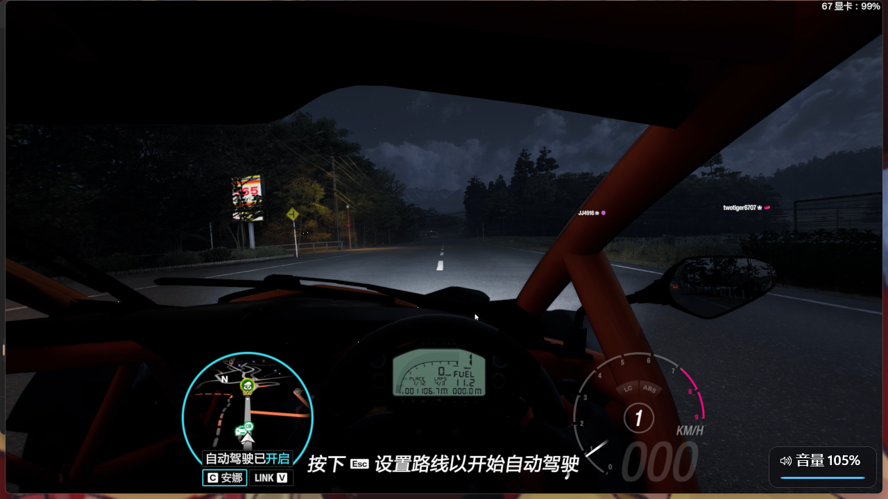
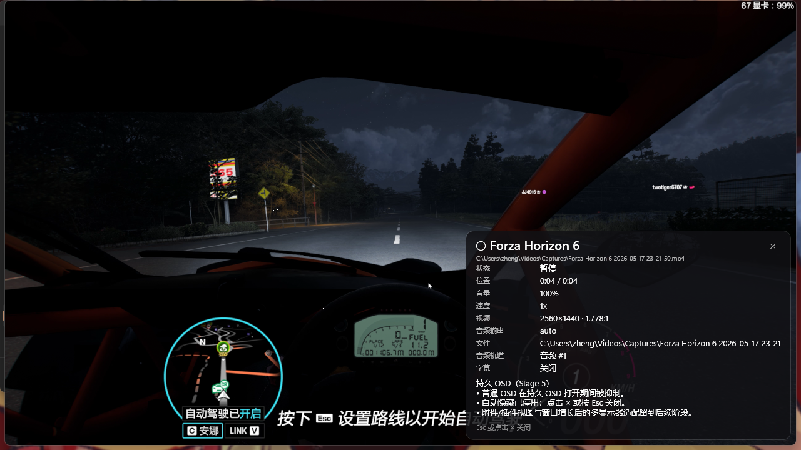
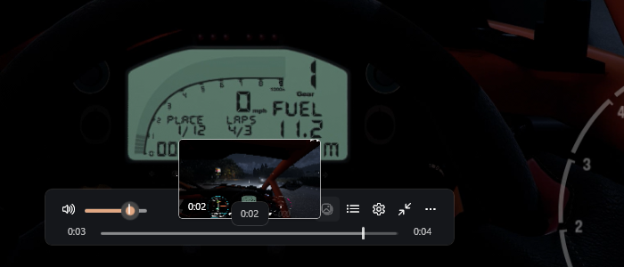

# Stage 5 — OSD 与时间/缩略图预览（验收包）

- **分支**：`stage/5-osd`（本分支 HEAD）
- **日期**：2026-10-18
- **环境**：Windows 11 25H2 26200；.NET SDK 10.0.402；
  Windows App SDK 2.5.1；libmpv 0.41.0（`third_party/libmpv/libmpv-2.dll`）。
- **测试媒体**：`C:\Users\zheng\Videos\Captures\Forza Horizon 6 2026-05-17 23-21-50.mp4`
  （2560×1440、4.5 s，仅用于本机冒烟，不提交）。
- **截图**：已复制到 `docs/acceptance/assets/stage-5-*.png`。

## 1. 交付范围

### 1.1 OSD 模型与渲染

- 新增 Core `OsdMessage` / `OsdMessageKind` / `OsdIcons` / `OsdMessages`：
  `normal`、`withText`（次要文本）、`withProgress`（进度条）、
  `withPosition`（位置/时长，强制 LTR）、`volume`、`seek`、`speed`、
  `track`、`subtitle`、`pause`、`AB`、`screenshot`、`error`、
  `buffer`、`network`。
- 新增 Core `OsdQueue`：单条覆盖策略；音量/跳转/速度/缓存类消息
  合并更新当前卡片，其余消息（暂停/轨道/错误等）不合并；
  每次显示重置计时器。`OsdSettings` 负责 1–500% 字号、0.1–30 s 时长、
  主字号 20、次要字号 10（主字号 × 0.5，clamp 10–25）、图标 0.8×。
- `OsdText` 重写为真实 OSD：
  - Segoe Fluent Icons 图标 + 主文本 20 DIP + 次要文本 10 DIP +
    12 DIP 进度条；圆角 12；内边距 16×8；右下默认 8 DIP 边距。
  - 深色半透明背景（主题 token `OsdBackgroundBrush` / `OsdProgressTrackBrush`）；
    浅色主题有对应画刷。
  - 显示时只更新内容、不重复淡入；新消息重置 1 s 计时；
    0.5 s 淡出；尊重系统与应用“减少动画”。
  - 错误消息带 `AlwaysShow`，关闭 OSD 后仍显示。
- 持久 OSD：`ShowPersistent(title, subtitle, details, body)`，
  普通 OSD 在持久 OSD 打开期间被抑制，自动隐藏停用；
  可滚动技术信息、附件区（详情/正文）、关闭按钮 × 与 `Esc`；
  窗口小于 560×360 时临时放大到 560×360，关闭时恢复原尺寸。
  普通 OSD 与持久 OSD 仍使用同一 `OsdText` 控件。
- 位置/字号/时长/持久开关存入 `AppSettings`：
  `OsdEnabled`、`OsdPosition`（右下/左下/右上）、`OsdSizePercent`、
  `OsdDurationSeconds`、`OsdPersistent`；布局页新增“OSD 与预览”卡片，
  并暴露全屏时钟/电量/标题、时间轴缩略图开关。

### 1.2 缓冲/状态指示

- 新增 `BufferIndicator` 居中状态胶囊（ProgressRing + 文案/详情）。
- `MpvPlayer` 观察 `paused-for-cache`、`seeking`、
  `cache-buffering-state`、`cache-speed`、`demuxer-cache-state`。
- 主窗口根据这些事件显示：
  - `paused-for-cache` / `cache-buffering-state < 99.5`：`正在缓冲…`
    + 百分比 + 缓存速度；
  - 网络流 seek：`正在跳转…`；
  - 打开 URL：`正在打开流…`（流地址截断显示）。
- 缓冲指示器与 OSD 独立，不占用 OSD 自动隐藏计时器。
- 全屏左下 `FullscreenInfo`：18 DIP Consolas 粗体时钟（每秒刷新）、
  电池/交流电源状态（10 s 采样，`GetSystemPowerStatus`）、
  可选标题；仅全屏且 UI 可见时显示，UI 隐藏时同步隐藏。

### 1.3 时间预览与缩略图

- 时间预览：主时间 + 章节标题（有章节时）；水平跟鼠标并 clamp；
  默认在进度条上方 8 DIP，放不下时改到下方；顶部 OSC 自动落到下方。
- 新增 `ThumbnailPeek` 叠加层：4 DIP 圆角、1 px 半透明边框、
  ThemeShadow；优先显示加载态，缩略图就绪后替换。
- 新增 `ThumbnailService`：第二个 headless libmpv 实例，
  按时间桶 seek 后 `screenshot-raw`；BGRA/BGR0/RGBA/RGB0 归一化，
  bilinear 缩放到目标高度约 90 DIP（16:9 → 160×90）。
  所有 mpv 调用、像素拷贝和缩放都在后台线程；UI 只接收最终 BGRA。
  `screenshot-raw` 失败时回退 `screenshot-to-file`（%TEMP% PNG →
  `BitmapDecoder`），随后删除临时文件。
- Core `ThumbnailCache<T>`：按 5 s 桶（可配置）做 LRU，默认 60 张；
  命中/替换/淘汰/清空均有回调；UI 侧用请求序号 + `CancellationToken`
  丢弃过期结果，服务端按桶去重 in-flight 请求。
- 互斥：拖动进度条、OSD 覆盖进度条、侧栏可见时隐藏时间预览/缩略图；
  缩略图未就绪时只显示时间预览；无视频/截图失败时静默回退。

### 1.4 其它

- 新增 `Ctrl+Alt+I` 与 `I` 打开持久技术信息 OSD；`Esc` 关闭。
- 新增 `MpvScreenshotReader`：直接解析 `mpv_node` 的
  `MPV_FORMAT_BYTE_ARRAY`，避免 4K 帧复制成大量托管对象。
- `MpvPlayer.Start(width, height, headless: true)`：无窗口、无音频、
  暂停、keep-open，用于缩略图后台实例。
- 沿用 Stage 0–4：标题栏自动隐藏、三种 OSC、播放/轨道/字幕/章节/
  播放列表/历史、Acrylic 侧栏与快速设置不变。

## 2. 构建与测试

```powershell
& "$env:USERPROFILE\.dotnet\dotnet.exe" build .\Wiina.slnx -c Debug
& "$env:USERPROFILE\.dotnet\dotnet.exe" test .\tests\Wiina.Core.Tests\Wiina.Core.Tests.csproj -c Debug
```

最终结果：

- Build：**0 warnings / 0 errors**。
- Tests：**244 passed / 0 failed / 0 skipped**（原有 187 + 新增 57：
  `OsdMessageTests`、`ThumbnailCacheTests`、`FullscreenClockTests`）。

## 3. 验收清单

| # | 项目 | 结果 | 证据/备注 |
|---|---|---|---|
| 1 | OSD 图标 + 主文本 + 次要文本 | ✅ 桌面 | 暂停/音量/跳转 OSD 截图；`OsdText.xaml` |
| 2 | 进度条、左到右时间/位置 | ✅ 桌面 | 音量 105% 进度条；跳转 `0:04 / 0:04` |
| 3 | 字号/圆角/内边距/边距/背景 | ✅ 代码 + 桌面 | 20/10/12 DIP；12 圆角；16×8；8 边距 |
| 4 | 单条覆盖、不堆叠 | ✅ 单测 + 代码 | `OsdQueueTests` 合并/覆盖/版本 |
| 5 | 每次消息重置 1 s、0.5 s 淡出 | ✅ 代码；计时未录屏 | `OsdText` DispatcherQueueTimer/Storyboard |
| 6 | 减少动画 | ✅ 代码 | `OsdText.AnimationsEnabled` + 主窗口开关 |
| 7 | 持久 OSD 抑制普通 OSD、停用自动隐藏 | ✅ 桌面 | `I` 打开技术信息，等待 >5 s 仍显示 |
| 8 | 持久 OSD 关闭按钮/ESC | ✅ 桌面 | `Esc` 后持久卡片消失 |
| 9 | 持久 OSD 窗口放大 | ✅ 代码 | <560×360 → 560×360，关闭恢复 |
| 10 | OSD 位置（右下/左下/右上）/字号/时长 | ✅ 代码 + 布局页 | 卡片控件与 `AppSettings` 持久化 |
| 11 | 全屏时钟 + 电量/交流电源 | ✅ 桌面 | F11 后左下 `20:47:28 · 交流电源` |
| 12 | 标题可选、UI 隐藏时隐藏 | ✅ 代码 | `FullscreenTitleEnabled`；`FadeChrome` 联动 |
| 13 | 缓冲/seek/网络提示 | ✅ 代码；⚠️ 未触发真实缓存 | `BufferIndicator` + mpv 属性观察 |
| 14 | 时间预览时间 + 章节标题 + clamp | ✅ 桌面 | 悬停时间轴显示 `0:02` 胶囊 |
| 15 | 缩略图 160×~90、时间桶缓存 | ✅ 桌面 | 悬停生成 16:9 缩略图；桶 5 s |
| 16 | LRU 60/去重/取消/回退 | ✅ 单测 + 代码 | `ThumbnailCacheTests`；服务 in-flight 字典 |
| 17 | 拖动/OSD 覆盖/侧栏时隐藏预览 | ✅ 代码 | `ShowTimePreview` 条件 + `HideTimePreview` |
| 18 | 1080p/4K 生成不阻塞 UI | ✅ 桌面/探针 | 4K `screenshot-raw` 约 40–74 ms，后台线程 |
| 19 | 无新增 NuGet / 无二进制提交 | ✅ | 仅现有 WinAppSDK/xUnit |
| 20 | 不回归 Stage 1–4 | ✅ 构建/测试 + 桌面 | OSC/侧栏/播放/键盘保留 |

## 4. 桌面冒烟（GUI）

运行：

```powershell
.\src\Wiina.App\bin\x64\Debug\net10.0-windows10.0.26100.0\win-x64\Wiina.exe `
  "C:\Users\zheng\Videos\Captures\Forza Horizon 6 2026-05-17 23-21-50.mp4"
```

通过 `SendKeys`、Win32 鼠标和 CUA 在真实桌面验证：

- 启动、加载 2560×1440 视频、mpv 初始化、无崩溃；标题为媒体标题。
- `Space`：右下 OSD 显示图标 + `播放/暂停`，约 1 s 后自动淡出。
- `Up`：右下 OSD 显示 `音量 105%` + 蓝色进度条；图标/圆角/半透明背景正确。
- `Right`：OSD 显示 `0:04` 主文本、`0:04` 次要文本、进度条，LTR。
- `F11`：全屏；底部 OSC 显示；左下 `20:47:28` + `交流电源`；
  桌面无电池，电池百分比路径未触发。
- `I`：右下持久技术信息 OSD：标题/路径/状态/位置/音量/速度/视频尺寸/
  音频输出/文件/音频轨道/字幕/正文；等待 >5 s 不自动隐藏。
- `Esc`：持久 OSD 关闭，普通 OSD 自动隐藏恢复正常。
- 悬停时间轴：显示时间预览胶囊；约 1–2 s 后 `ThumbnailPeek` 显示
  16:9 缩略图（时间徽标 `0:02`），位于时间预览上方。
- 打开快速设置侧栏（`Ctrl+Shift+S`）：布局页可见“OSD 与预览”卡片
  （启用 OSD、位置、字号、停留时间、持久开关、全屏时钟/电量/标题、
  时间轴缩略图）；滚动条可继续向下。
- 关闭窗口后 `Get-Process Wiina` 为空；`%TEMP%` 缩略图临时文件被清理。
- 首帧缩略图服务启动时 libmpv 会输出
  `vo/gpu-next/d3d11: Failed to query swap chain's output information`；
  这是 headless composition 的无窗口日志，`screenshot-raw` 仍成功，
  不影响主播放器。

## 5. 已知问题 / 偏差

1. **持久 OSD 附件视图是文本/技术信息版**：未接入插件 WebView、在线字幕
   选择、截图预览等任意附件；详情/正文/滚动/关闭/窗口放大已实现。
   规格中的“附件最小 240×300、按比例放大”只做了窗口最小值，不做多显示器适配。
2. **缩略图仅本地文件**：URL/网络流不生成缩略图（避免二次下载/阻塞）；
   无视频轨道或 `screenshot-raw` 失败时只显示时间预览。
3. **缩略图首次延迟**：第一个请求要启动第二个 libmpv 并加载文件，
   本机约 1–2 s；之后按 5 s 桶命中缓存。未做预生成/预取队列。
4. **回退路径未实测**：`screenshot-raw` 在本机全部成功；
   `screenshot-to-file + BitmapDecoder` 回退已实现但未用真实失败场景验证。
5. **缓冲/网络提示未触发真实网络流**：本地 4.5 s 片源没有
   `paused-for-cache`；代码路径与属性观察已接，需 Lead 用真实 HTTP/HLS
   或慢速磁盘验证百分比/速度文案。
6. **OSD 位置左/上未逐项截图**：右下默认位置已桌面验证；
   左下/右上只做了代码与设置联动，Quick Settings 可切换。
7. **全屏电量未验证电池设备**：桌面显示交流电源；电池百分比/充电中
   走 `GetSystemPowerStatus`，需笔记本/电池环境补测。
8. **1 s/0.5 s 计时未录屏测量**：截图只能证明内容/样式与持久显示；
   自动隐藏时长需 Lead 录屏确认。
9. **时间预览位置**：按规格“进度条上方 5–8 DIP”放置，因此会落在
   浮动 OSC 控制行上方/内部边缘；缩略图已改为相对时间预览再上移 5 DIP，
   不再被时间预览遮挡。顶部 OSC 时两者落到进度条下方。
10. **缩略图缓存为缩放后 BGRA 字节**：每张约 57 KB（160×90×4），
    60 张约 3.4 MB；`ThumbnailPeek` 隐藏时清空 `Image.Source`。
    `BitmapImage` 不实现 `IDisposable`，因此“释放位图”通过清空引用 +
    字节缓存淘汰回调实现。
11. **未提交截图**：按任务要求截图留给 Lead；本文件只记录观察。
12. **stage 分支状态**：未 commit/push；全部改动未提交。

## 6. 变更文件

新增：

- `src/Wiina.Core/Osd/OsdMessage.cs`
- `src/Wiina.Core/Osd/OsdQueue.cs`
- `src/Wiina.Core/Caching/ThumbnailCache.cs`
- `src/Wiina.Core/Text/FullscreenClock.cs`
- `src/Wiina.App/Controls/BufferIndicator.xaml(.cs)`
- `src/Wiina.App/Controls/FullscreenInfo.xaml(.cs)`
- `src/Wiina.App/Controls/ThumbnailPeek.xaml(.cs)`
- `src/Wiina.App/MainWindow.Osd.cs`
- `src/Wiina.App/Services/ThumbnailService.cs`
- `src/Wiina.Mpv/MpvScreenshot.cs`
- `tests/Wiina.Core.Tests/OsdMessageTests.cs`
- `tests/Wiina.Core.Tests/ThumbnailCacheTests.cs`
- `tests/Wiina.Core.Tests/FullscreenClockTests.cs`

修改：

- `src/Wiina.App/Controls/OsdText.xaml(.cs)`（完整 OSD + 持久 OSD）
- `src/Wiina.App/Controls/QuickSettingsView.xaml(.cs)`（OSD/预览设置）
- `src/Wiina.App/MainWindow.xaml`（BufferIndicator/FullscreenInfo/ThumbnailPeek）
- `src/Wiina.App/MainWindow.xaml.cs`（Stage 5 初始化、预览互斥、全屏状态）
- `src/Wiina.App/MainWindow.Playback.cs`（OSD 类型、网络/缓冲事件、`I` 快捷键）
- `src/Wiina.App/MainWindow.Sidebar.cs`（快速设置 OSD 项、重置）
- `src/Wiina.App/Themes/Tokens.xaml`（OSD/状态/缩略图主题 token）
- `src/Wiina.Core/Models/AppEnums.cs`（`OsdPosition`）
- `src/Wiina.Core/Settings/AppSettings.cs`（OSD/全屏/缩略图字段）
- `src/Wiina.Mpv/MpvInterop.cs`（`mpv_command_node`）
- `src/Wiina.Mpv/MpvPlayer.cs`（headless 启动、截图、缓存/seek 属性）

## 7. 许可证 / 仓库卫生

- [x] 无新增 NuGet/第三方依赖（仅现有 Windows App SDK / xUnit）。
- [x] 未复制 IINA 源码、`.xcassets`、SF Symbols 或图标；XAML/C# 为原创。
- [x] 仓库未提交 libmpv 二进制、测试媒体或截图；libmpv 仍在
  `third_party/libmpv/`（gitignored）。
- [x] 未改变 GPL-3.0-only。
- [x] 未提交、未推送；分支保持 `stage/5-osd`。
- [x] 冒烟结束后无 Wiina 进程残留；临时缩略图位于 `%TEMP%` 并由服务删除。

## 截图

### 音量 OSD（图标 + 文本 + 进度）



### 持久技术 OSD



### 时间预览 + 缩略图



