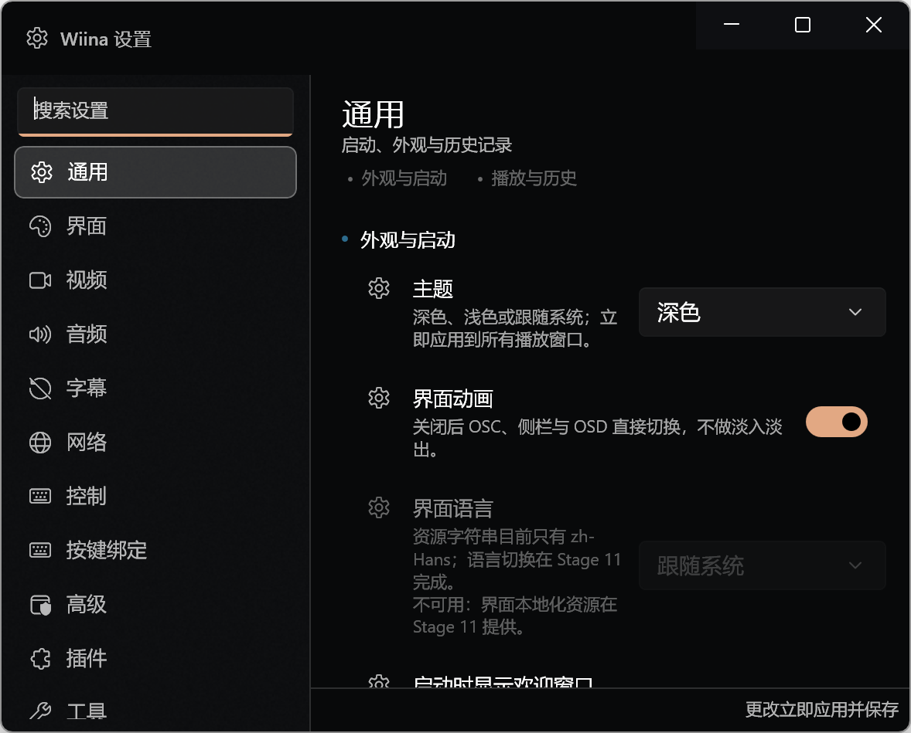
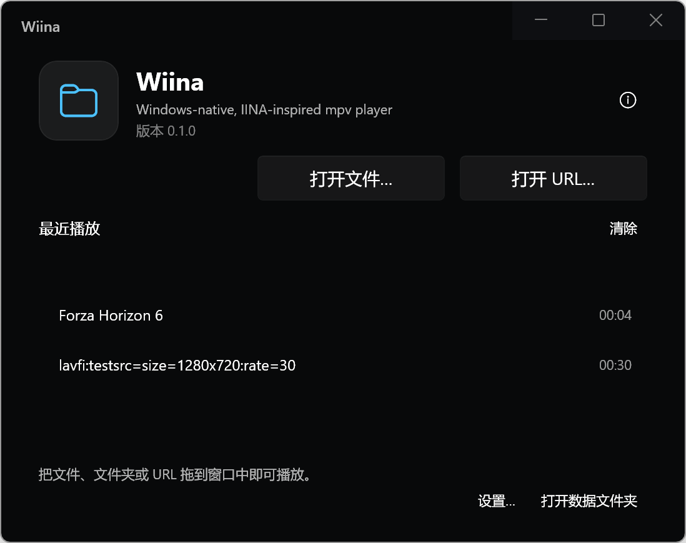

# Stage 7 — 设置、菜单、欢迎与辅助窗口（验收包）

- **分支**：`stage/7-settings`（本分支 HEAD）
- **日期**：2026-10-18
- **环境**：Windows 11 25H2 26200；.NET SDK 10.0.402；
  Windows App SDK 2.5.1；libmpv 0.41.0（客户端 API 2.6，
  `third_party/libmpv/libmpv-2.dll`）；桌面缩放 200%（100% 时逻辑尺寸不变）。
- **测试媒体**：
  - 视频：`C:\Users\zheng\Videos\Captures\Forza Horizon 6 2026-05-17 23-21-50.mp4`
  - 无媒体：直接启动（欢迎窗口路径）
- **截图**：`docs/acceptance/assets/stage-7-*.png`。

## 1. 交付范围

### 1.1 Core：设置目录、搜索、菜单规则与按键模型

新增：

- `src/Wiina.Core/Settings/SettingsModels.cs`：
  `SettingsPageId`（General/UI/Video/Audio/Subtitles/Network/Control/KeyBindings/
  Advanced/Plugin/Utilities）、`SettingsPageInfo`、`SettingsRowKind`、
  `SettingsRowDefinition`（Id/Page/Section/Title/Description/Keywords/Kind/
  Choices/Min/Max/Step/Suffix/UnavailableReason/ActionId/Get/Set）。
- `src/Wiina.Core/Settings/SettingsCatalog.cs`：
  11 页、88 行；每行的 getter/setter 直接作用于 `AppSettings`；
  不可用行带明确原因（语言、yt-dlp、插件安装、滤镜等）。
  页内分区（sections）按行顺序去重，供侧栏圆点使用。
- `src/Wiina.Core/Settings/SettingsSearch.cs`：
  纯搜索索引，按“标题精确 > 标题前缀 > 词首 > 标题包含 > 关键词 >
  说明 > 分区 > 页面”排序；页面命中在无行命中时补充；结果稳定去重。
- `src/Wiina.Core/Input/KeyBindings.cs`：
  `KeyBindingSetting`、`PlayerActionCatalog`（动作标签/分类）、
  `KeyBindings`（默认表、`Resolve`、`BuildKeyMap`、冲突检测、
  `SetBinding`/`ClearAction`/`ResetAction`/`Normalize`、
  JSON 导入导出、未知动作与坏 chord 容错）。
- `src/Wiina.Core/Menu/MenuCatalog.cs`：
  8 个顶级菜单、`MenuState`、`MenuCommands`、动态标题/勾选/启用规则、
  速度/循环/宽高比/裁剪/旋转子菜单；动态轨道/设备/最近文件由 App 追加。
- `src/Wiina.Core/History/RecentList.cs`：最近列表去重、前插、容量限制。
- `src/Wiina.Core/Text/InputValidation.cs`：
  `UrlValidation`（http/https/rtmp/rtsp/ftp 等，补 `https://`，拒绝
  `mailto:`/磁盘路径/空白/超长）、`FontNameValidation`。

修改：

- `src/Wiina.Core/Settings/AppSettings.cs`：欢迎窗口、设置页、窗口位置恢复、
  语言占位、字幕字体、缓存（MiB）、代理/UA/超时、mpv 日志级别、
  yt-dlp 路径、滚轮反向、`List<KeyBindingSetting> KeyBindings`。
- `src/Wiina.Core/Input/KeyMap.cs`：默认表改为复用
  `KeyBindings.BuildKeyMap(null)`，避免两份默认键位漂移。

### 1.2 设置窗口（独立 WinUI 3 窗口）

新增 `src/Wiina.App/Views/SettingsWindow.xaml(.cs)`：

- 600×480 DIP（`WindowShell` 按 DPI 换算物理像素，200% 下 1200×960），
  可缩放，内容最小 400；左侧固定 200 DIP 的 Acrylic 导航，
  顶部搜索框；右侧页面标题/说明 + `ScrollViewer` 卡片行。
- 11 页：General / UI / Video / Audio / Subtitles / Network / Control /
  Key Bindings / Advanced / Plugin / Utilities，顺序与规格 §12.1 一致。
- 行样式：24 图标列 + 标题 13 + 说明 11 + 右侧控件；
  不可用行整行置灰、控件禁用，并在说明后追加“不可用：原因”。
- 搜索：输入即出 popover 列表（页面/标题/说明/关键词），
  点击或 Enter 跳到对应页并滚动到行，随后 1 s 强调色描边高亮；
  Esc 清空并关闭结果。分区圆点位于页面标题/摘要下方，点击滚动到分区。
- 应用策略（文档化）：**实时生效 + 350 ms 防抖持久化**；
  开关/下拉/动作立即保存，数值/文本防抖保存；
  保存走 `App.SaveSettings()`，其它窗口通过 `App.SettingsChanged` 重新应用。
  当前窗口额外调用 `App.ActiveWindow?.ApplySettingsRow(rowId)`，
  让 mpv 属性（hwdec/比例/裁剪/字幕样式/缓存/网络/日志级别）即时生效。
- 页面内容全部来自现有 `AppSettings` 与快速设置选项，没有空占位控件；
  Advanced 提供重置全部、打开配置/日志/插件文件夹、导出诊断、
  清空历史、清空缩略图缓存；Plugin 页为 Stage 9 的禁用占位（带原因）；
  Utilities 提供字体、打开 URL、日志、检查器、关于、技术信息 OSD。
- 按键编辑页：按分类列出动作与当前 chord；录制（Esc 取消、
  Backspace 清除）、冲突提示（替换/取消）、重置此项/全部、
  导入/导出 JSON；保存后设置持久化并即时重建当前窗口 KeyMap。

### 1.3 菜单树

新增 `src/Wiina.App/MainWindow.Menu.cs`：

- File / Playback / Video / Audio / Subtitles / Plugin / Window / Help
  八个顶级菜单，菜单项来自 Core `MenuCatalog`；每次打开重建，
  因而启用/勾选/标题始终反映当前状态。
- File：打开文件/文件夹/URL、新窗口打开、播放列表、打开最近（动态，
  含清除）、保存播放列表、截图到文件夹、关闭、退出。
- Playback：播放/暂停（暂停↔继续播放）、停止、停止并清空、
  ±5 s、逐帧、跳到开头、速度子菜单、截图、A-B、循环模式、随机、
  上一首/下一首、显示播放列表/章节、上一章/下一章。
- Video：视频面板、视频轨道（动态，含自动/关闭）、窗口 0.5/1/2×、
  适合屏幕、放大/缩小、PiP、全屏、置顶、锁定宽高比、音乐模式、
  宽高比/裁剪/旋转、水平/垂直翻转、去隔行；滤镜项禁用并注明 Stage 8。
- Audio：音频面板、音频轨道、音量 ±5/±1、静音、延迟 ±0.1/归零、
  音频设备（动态）、音频滤镜禁用（Stage 8）。
- Subtitles：面板、字幕轨道、显隐、次字幕、加载外挂、在线字幕禁用
  （Stage 10）、延迟/位置/缩放、字体、字幕设置。
- Plugin：管理/安装禁用并注明 Stage 9；打开插件文件夹可用。
- Window：新建、在新窗口打开、最小化、最大化/还原、窗口尺寸、
  检查器、日志查看器、设置、关闭。
- Help：欢迎窗口、关于、键盘快捷键、打开日志文件夹、导出调试信息、GitHub。
- 入口：标题栏“更多”按钮与三个 OSC 工具栏“更多”按钮（同一菜单）；
  快捷键文本随菜单项显示；无障碍 Name 由 XAML/UIA 提供。
- 选择飞行菜单而不是常驻 `MenuBar`：保持 Stage 1–6 的扩展标题栏、
  自动隐藏与视频铺满不被破坏（任务允许二者之一）。

### 1.4 欢迎与辅助窗口

- `Views/WelcomeWindow.xaml(.cs)`：560×440 DIP；应用图标/版本/信息按钮、
  打开文件/打开 URL、继续播放行（有断点时才显示）、最近列表（双击打开）、
  清除最近、拖放文件/文件夹/URL/文本、设置与数据文件夹入口；
  启动时无媒体且 `ShowWelcomeWindow` 为真则显示。
- `Views/AboutWindow.xaml(.cs)`：版本、GPL-3.0-only、libmpv 客户端 API、
  WinUI/Windows App SDK、.NET/OS、项目主页、非关联声明、复制信息。
- `Views/LogViewerWindow.xaml(.cs)`：跟踪/崩溃/全部过滤、2 s 自动刷新、
  刷新/打开文件夹/复制，读取 %TEMP% 跟踪日志与 %LOCALAPPDATA% 崩溃日志尾部。
- `Views/InspectorWindow.xaml(.cs)`：文件/播放/视频/音频/字幕/轨道/
  播放列表/章节分组，只读可选中，1.5 s 自动刷新与复制；
  数据来自活动窗口实时 mpv 属性（`MainWindow.GetInspectorSnapshot()`）。
- `Views/Dialogs.cs`：打开 URL（实时校验、最近地址、新窗口选项）、
  字幕字体选择（常用字体 + 可编辑家族名、预览）、确认/提示对话框。
- `Services/WindowShell.cs`：二级窗口统一 DPI 尺寸、Mica、扩展标题栏、
  caption 按钮配色、最小尺寸、文件选择器 HWND 初始化。
- 首次启动：默认 `AppSettings` + 欢迎窗口；**本阶段不写注册表、不做文件关联**；
  `App.IsFirstRun` 仅用于诊断导出。

### 1.5 播放器接入

- `MainWindow.Settings.cs`：`BuildMenuState`、`ApplySettingsRow`、
  `ApplyStage7Settings`、`RebuildKeyMap`、`GetRendererInfo`、
  `GetInspectorSnapshot`、音频延迟调整、`ClearThumbnailCache`。
- `MainWindow.Menu.cs`：`ShowApplicationMenu` 与 `ExecuteMenuCommand`，
  覆盖全部命令；未知命令写 trace，不静默失败。
- `MainWindow.Playback.cs`：更多菜单改为应用菜单；打开 URL 走统一校验对话框；
  最近 URL 使用 `RecentList`；滚轮反向设置生效；音频设备缓存；
  删除 Stage 3 的临时设置对话框与旧菜单构建代码。
- `MainWindow.Modes.cs`：共享设置变化时重建 KeyMap 并重新应用 Stage 7 设置。
- `App.xaml.cs`：设置/欢迎/关于/日志/检查器单例窗口；`DataFolder`、
  `LogsFolder`、`PluginsFolder`、`ConfigFolder`、`TraceLogPath`、`CrashLogPath`；
  `OpenMedia`、`OpenFolder`、`ClearHistory`、`ExportDiagnostics`、
  原地 `ResetSettings`（保留按键、最近列表与窗口 frame）。
- `src/Wiina.Mpv/MpvPlayer.cs`：`SetLogLevel`，启动时按设置请求日志级别。
- `src/Wiina.Mpv/MpvRuntime.cs`：libmpv 可用性/客户端 API 版本。

## 2. 构建与测试

```powershell
& "$env:USERPROFILE\.dotnet\dotnet.exe" build .\Wiina.slnx -c Debug
& "$env:USERPROFILE\.dotnet\dotnet.exe" test .\tests\Wiina.Core.Tests\Wiina.Core.Tests.csproj -c Debug
```

最终结果：

- Build：**0 warnings / 0 errors**。
- Tests：**366 passed / 0 failed / 0 skipped**
  （Stage 6 的 295 + 新增 71：`SettingsSearchTests`、`KeyBindingTests`、
  `MenuRulesTests`、`RecentListTests`、`InputValidationTests`）。

## 3. 验收清单

| # | 项目 | 结果 | 证据/备注 |
|---|---|---|---|
| 1 | 设置窗口 11 页、顺序、200 DIP 导航、内容 ≥400 | ✅ | XAML + UIA 树；200% 下窗口 1178×949 预览（≈589×474 DIP） |
| 2 | 搜索按页面/标题/说明过滤、跳转并高亮、Esc 清空 | ✅ | 输入“主题”出现 1 条结果；Enter 跳转并清空；Esc 关闭面板 |
| 3 | 分区圆点、点击滚动、不可用行置灰并注明原因 | ✅ | 通用页“界面语言”禁用并显示 Stage 11 原因；圆点在页面标题/摘要下方，点击滚动 ||
| 4 | General/UI/Video/Audio/Subtitles/Network/Control 全部接线 | ✅ | 目录 getter/setter + `ApplySettingsRow`；单测覆盖往返 |
| 5 | 设置实时生效并持久化，与快速设置同步 | ✅ | 保存走 `App.SaveSettings()`；共享 `App.Settings` |
| 6 | Advanced：重置、配置/日志/插件文件夹、诊断、清缓存 | ✅ | 动作行均调用真实 API；重置原地保留按键/历史/frame |
| 7 | Plugin 页 Stage 9 占位、禁用并说明原因 | ✅ | “未安装插件”、安装按钮禁用 |
| 8 | Utilities：字体、URL、日志、检查器、关于、技术 OSD | ✅ | 字体/URL 对话框；日志/检查器/关于窗口实测打开 |
| 9 | 8 个顶级菜单、子菜单、动态启用/勾选/标题 | ✅ | 无媒体时 File 可打开、Playback 全部禁用；Video/Window/Help 可用 |
| 10 | 无媒体禁用媒体项、插件项禁用、滤镜/在线字幕注明阶段 | ✅ | UIA 读取菜单项 enabled 状态；Core 规则单测 13 条 |
| 11 | 最近文件子菜单、清除、撤销最近 | ✅ | `RecentList` + `HistoryStore`；欢迎页同样入口 |
| 12 | 欢迎 560×440、最近、继续播放、拖放、双击打开 | ✅ | 启动自动出现；DPI 修正后布局完整；断点行按需显示 |
| 13 | 关于窗口版本/GPL/mpv/WinUI | ✅ | 实测 libmpv API 2.6、GPL-3.0-only、WinUI 3.0.0.0 |
| 14 | 日志查看器过滤/刷新/打开文件夹/复制 | ✅ | 实测显示 `%TEMP%\wiina-trace.log` 尾部；崩溃日志不存在时显示提示 |
| 15 | 检查器技术信息来自 mpv 缓存/属性 | ✅ | 实测 d3d11 渲染 API/上下文；无媒体显示“—/直播或未知” |
| 16 | 按键编辑：录制、冲突、重置单项/全部、导入导出、持久化 | ✅ | 录制写入 settings.json；冲突逻辑单测；Esc/Backspace 处理 |
| 17 | 默认键位保持 Stage 3–6 全部可用 | ✅ | `KeyMap.CreateDefault()` 复用同一默认表；366 测试含 KeyChord |
| 18 | 首次启动默认设置 + 欢迎；不写注册表/文件关联 | ✅ | 代码路径无注册表调用；文档记录 |
| 19 | 0 errors / 0 new warnings；无新增 NuGet | ✅ | 构建输出；仅现有 WinAppSDK/xUnit |
| 20 | 无 IINA 源码/资产/SF Symbols；GPL-3.0-only | ✅ | 全部原创 XAML/C#；图标来自 Segoe Fluent Icons |

## 4. 桌面冒烟（GUI）

```powershell
# 无媒体：欢迎窗口
.\src\Wiina.App\bin\x64\Debug\net10.0-windows10.0.26100.0\win-x64\Wiina.exe

# 有媒体：跳过欢迎窗口
.\src\Wiina.App\bin\x64\Debug\net10.0-windows10.0.26100.0\win-x64\Wiina.exe `
  "C:\Users\zheng\Videos\Captures\Forza Horizon 6 2026-05-17 23-21-50.mp4"
```

观察（2026-10-18，多个临时 PID，全部已结束）：

- 无媒体启动出现两个顶层窗口：`Wiina`（视频窗口）与 `欢迎使用 Wiina`；
  欢迎页图标/版本/两个大按钮/最近列表/拖放提示/设置入口均可见，
  200% 缩放下窗口为 560×440 DIP。
- 欢迎页“设置…”打开设置窗口；DPI 修正前 600×480 被当作物理像素
  （200% 下只有 300×240 DIP，内容裁切）；修正 `WindowShell` 后
  1178×949 预览 ≈ 589×474 DIP，布局完整。
- 设置窗口：左侧导航、搜索框、分区圆点；通用页显示主题/动画/语言/欢迎/
  续播/窗口位置/截图目录/数据目录；搜索“主题”出现结果，Enter 跳到
  主题行并清空搜索；按键绑定页显示动作/分类/chord，录制后写入
  `settings.json` 的 `KeyBindings` 并即时重建 KeyMap。
- 菜单：从标题栏/OSC“更多”打开；UIA 读到 8 个顶级菜单。
  File 中“打开文件/文件夹/URL/最近”可用，“保存播放列表/截图到文件夹”
  在无媒体时禁用；Playback 全部媒体项禁用，显示播放列表/章节可用；
  Plugin 管理/安装禁用（Stage 9 原因），打开插件文件夹可用。
- 有媒体启动：标题 `Forza Horizon 6`，视频 2560×1440 正常播放；
  Window → 检查器打开（渲染 d3d11/d3d11，无媒体时字段为占位）；
  Help → 关于显示 GPL、libmpv API 2.6、WinUI 3.0.0.0、.NET 10.0.13；
  Window → 日志查看器显示跟踪日志与“崩溃日志不存在”。
- 关闭所有窗口后 `Get-Process Wiina` 为空；未留下媒体/临时文件。

## 5. 已知问题 / 偏差

1. **设置窗口是“实时生效 + 防抖保存”**，没有 Apply/Close 双按钮；
   符合任务允许的两种策略，已在本文档与代码注释记录。
2. **语言切换占位**：`general.language` 行禁用并注明“Stage 11 提供本地化资源”，
   避免可点但无效果的控件。
3. **yt-dlp、在线字幕、插件安装、滤镜/EQ**：分别禁用并注明 Stage 10/9/8；
   插件页只显示空的已安装列表。
4. **菜单以飞出菜单呈现**（标题栏/OSC 更多），未使用常驻 `MenuBar`：
   保持扩展标题栏与自动隐藏布局；任务允许二选一。
5. **字体选择器**使用常用字体列表 + 可编辑家族名 + 预览；
   完整 DirectWrite 字体枚举留到 Stage 11（不影响已安装字体的手动输入）。
6. **日志查看器 XAML 精简**：原始版本在运行时 `XamlParseException`
   （`LoadComponent`），改为等价的最小布局（ComboBox/开关/按钮/只读 TextBox）
   后稳定；功能（过滤/自动刷新/打开文件夹/复制）全部保留。
7. **按键录制的自动化验证限制**：合成 `PostMessage` 不更新系统修饰键状态，
   自动化脚本录制得到 `J` 而非 `Ctrl+Alt+J`；真实键盘输入通过
   `GetKeyState` 正常获得修饰键。测试后已把 `settings.json` 的
   `KeyBindings` 恢复为空（= 默认表）。
8. **文件关联/注册表**：本阶段按计划不写；首次启动只应用默认设置并显示欢迎。
9. **截图**：已补录到 `docs/acceptance/assets/stage-7-*.png`。
10. **git 状态**：已提交并推送到 `stage/7-settings`。

## 6. 变更文件

新增：

- `src/Wiina.Core/Settings/SettingsModels.cs`
- `src/Wiina.Core/Settings/SettingsCatalog.cs`
- `src/Wiina.Core/Settings/SettingsSearch.cs`
- `src/Wiina.Core/Input/KeyBindings.cs`
- `src/Wiina.Core/Menu/MenuCatalog.cs`
- `src/Wiina.Core/History/RecentList.cs`
- `src/Wiina.Core/Text/InputValidation.cs`
- `src/Wiina.App/Views/SettingsWindow.xaml(.cs)`
- `src/Wiina.App/Views/WelcomeWindow.xaml(.cs)`
- `src/Wiina.App/Views/AboutWindow.xaml(.cs)`
- `src/Wiina.App/Views/LogViewerWindow.xaml(.cs)`
- `src/Wiina.App/Views/InspectorWindow.xaml(.cs)`
- `src/Wiina.App/Views/Dialogs.cs`
- `src/Wiina.App/Services/WindowShell.cs`
- `src/Wiina.App/MainWindow.Menu.cs`
- `src/Wiina.App/MainWindow.Settings.cs`
- `src/Wiina.Mpv/MpvRuntime.cs`
- `tests/Wiina.Core.Tests/SettingsSearchTests.cs`
- `tests/Wiina.Core.Tests/KeyBindingTests.cs`
- `tests/Wiina.Core.Tests/MenuRulesTests.cs`
- `tests/Wiina.Core.Tests/RecentListTests.cs`
- `tests/Wiina.Core.Tests/InputValidationTests.cs`

修改：

- `src/Wiina.App/App.xaml.cs`（二级窗口、文件夹/导出/重置、欢迎启动）
- `src/Wiina.App/MainWindow.xaml.cs`（更多菜单入口、Stage 7 设置应用、
  窗口位置恢复开关）
- `src/Wiina.App/MainWindow.Playback.cs`（菜单替换、URL 校验、
  最近列表、滚轮反向、音频设备缓存、移除临时设置对话框）
- `src/Wiina.App/MainWindow.Modes.cs`（共享设置变化时重建 KeyMap/应用设置）
- `src/Wiina.Core/Settings/AppSettings.cs`（Stage 7 设置项）
- `src/Wiina.Core/Input/KeyMap.cs`（复用默认绑定表）
- `src/Wiina.Mpv/MpvPlayer.cs`（日志级别）

## 7. 许可证 / 仓库卫生

- [x] 无新增 NuGet/第三方依赖。
- [x] 未复制 IINA 源码/资产/SF Symbols；XAML/C# 均为原创。
- [x] 未提交 libmpv 二进制、测试媒体或截图。
- [x] 保持 GPL-3.0-only。
- [x] 未执行 git commit/push。

## 8. 下一步

- 截图已补录；本阶段待验收。
- Stage 8 接管滤镜/EQ/高级音画；Stage 9 插件、Stage 10 在线字幕与 yt-dlp
  可复用本阶段的 Plugin/Network/Utilities 页与禁用原因。

## 截图

### 设置窗口（11 页 + 搜索 + 分区圆点）



### 欢迎窗口


