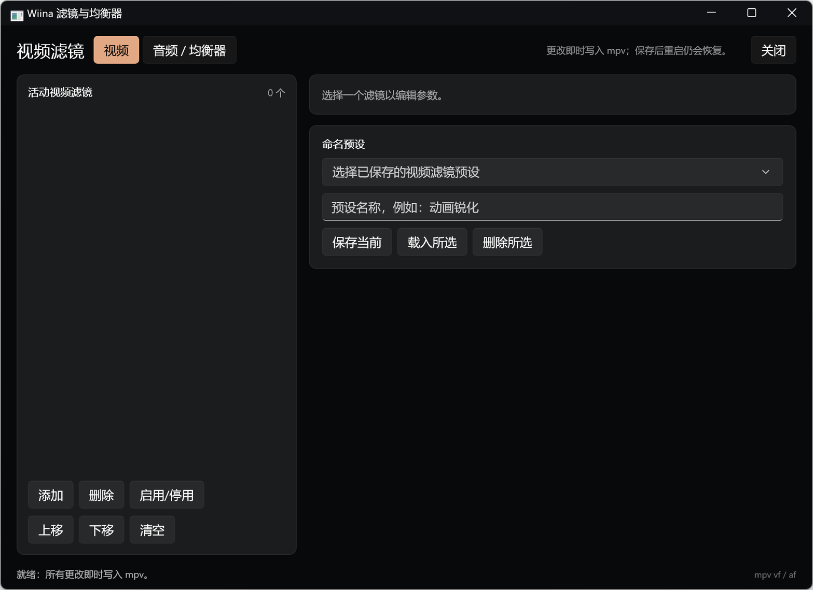
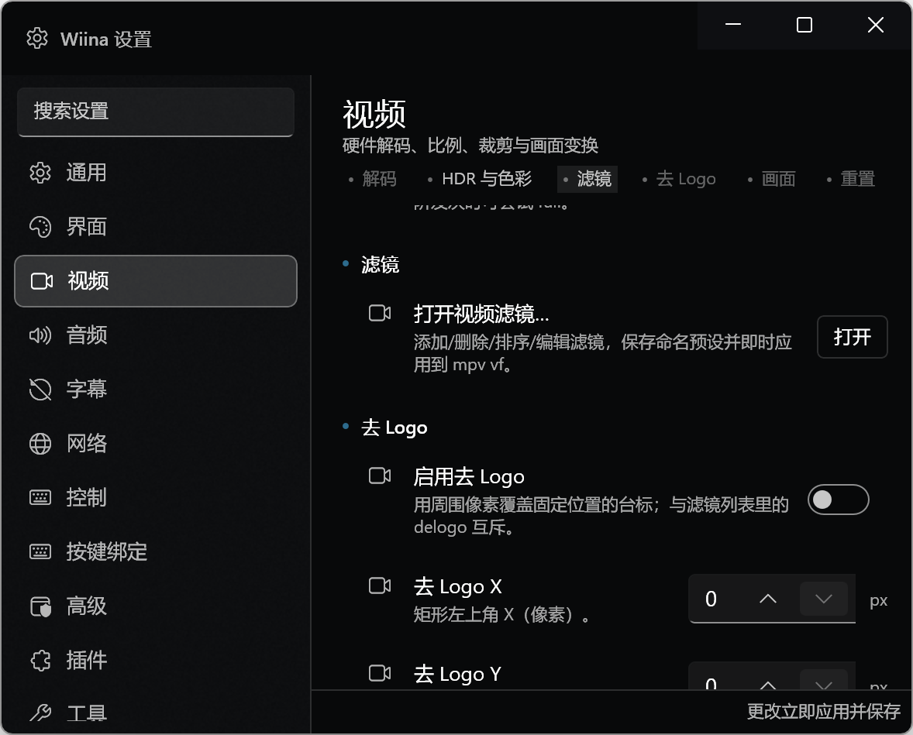

# Stage 8 — 滤镜、10 段均衡器与高级音画（验收包）

- **分支**：`stage/8-filters`（本分支 HEAD）
- **日期**：2026-10-18
- **环境**：Windows 11 25H2 26200；.NET SDK 10.0.402；
  Windows App SDK 2.5.1；libmpv 0.41.0（客户端 API 2.6，
  `third_party/libmpv/libmpv-2.dll`）；桌面缩放 200%。
- **测试媒体**：
  - 视频：`%TEMP%\wiina-stage8-sample.mp4`（Forza Horizon 6，
    h264 2560×1440 29.0425 fps，AAC 2ch 48 kHz）
  - 外挂字幕：`%TEMP%\wiina-stage8-test.ass`
- **截图**：`docs/acceptance/assets/stage-8-*.png`。

## 1. 交付范围

### 1.1 Core：滤镜图、均衡器、预设与检查器格式化

新增：

- `src/Wiina.Core/Filters/VideoFilters.cs`
  - `VideoFilterKind`：ColorAdjust / Sharpen / Denoise / Deband / Crop /
    Rotate / FlipHorizontal / FlipVertical / Deinterlace / Delogo /
    Format / Scale。
  - `VideoFilterSetting`（持久化参数）、`VideoFilterPreset`。
  - `VideoFilterCatalog`：名称、说明、参数范围/步长、参数读写、摘要文本。
  - `VideoFilterGraph.Build(...)`：
    - 保持列表顺序；
    - 旧版比例裁剪在前、旧版翻转在后，保留 Stage 2 顺序；
    - 旧版 delogo 与列表 delogo 互斥；
    - 同 kind 重复、越界 crop/delogo、非法 scale/format、旧版开关冲突
      均返回错误并跳过该项，不中断其它滤镜；
    - 旋转 90/180/270 → `transpose=1` / `hflip,vflip` / `transpose=2`；
    - 生成合法 mpv `vf` 字符串（空串清除）。
- `src/Wiina.Core/Filters/AudioFilters.cs`
  - `EqualizerBands`：31/62/125/250/500/1k/2k/4k/8k/16k Hz，
    −12…+12 dB，Flat/Rock/Jazz/Classical/Pop/Bass/Treble/Vocal 预设，
    自定义检测、增益规范化与钳制。
  - `BuildGraph` 使用本机 libmpv 实际支持的 FFmpeg 参数均衡器，
    每个非零频段一个 `equalizer=f=…:t=q:w=1:g=…` biquad；
    全部为 0 或禁用时返回空图。
  - `AudioFilterSetting`：loudnorm / dynaudnorm，以及参数校验；
  - `AudioFilterGraph.Build(...)`：EQ 在前，附加滤镜按列表顺序，
    返回错误并保留合法项。
  - 明确记录本机构建不支持 `pitch` / `rubberband`（窗口内展示）。
- `src/Wiina.Core/Diagnostics/InspectorFormatter.cs`
  - 字节、分辨率、帧率、码率、采样率、声道、HDR/色彩元组、
    SDR/HDR 判定、字幕轨道摘要、图像/ASS 字幕判定。
- `src/Wiina.Core/Subtitles/SubtitleStyleAdvisory.cs`
  - 图像字幕（PGS/VobSub）不可改样式；ASS/SSA 给出“部分样式由字幕决定”
    警告；纯文本可改样式。

修改：

- `src/Wiina.Core/Settings/AppSettings.cs`：
  `VideoFilters`、`VideoFilterPresets`、`AudioFilters`、`AudioFilterPresets`、
  `EqualizerEnabled`、`EqualizerGains[10]`、`EqualizerPreset`、
  `VideoToneMapping`、`VideoHdrComputePeak`、`VideoTargetPeak`、
  `VideoHwdecMode`、`VideoOutputLevels`、delogo 五项、
  `SubtitleAssOverride`、`SubtitleBold`、`SubtitleItalic`。
- `src/Wiina.Core/Settings/SettingsCatalog.cs`：
  启用/新增 Stage 8 行：
  - Video：滤镜入口、tone-mapping、HDR 峰值计算、target-peak、
    hwdec 模式、输出范围、去 Logo 开关/X/Y/宽/高；
  - Audio：10 段均衡器开关、预设、重置、音频滤镜入口；
  - Subtitles：ASS 覆盖、粗体、斜体、图像字幕提示。
- `src/Wiina.Core/Menu/MenuCatalog.cs`：
  “视频滤镜…”与“音频滤镜…”由禁用改为可用。

### 1.2 滤镜与均衡器窗口

新增 `src/Wiina.App/Views/FiltersWindow.xaml(.cs)`：

- 940×680 DIP，可缩放；视频 / 音频·均衡器两个标签。
- 视频：
  - 活动滤镜列表（名称 + 参数摘要 + 启用状态）；
  - 添加（12 种内置滤镜）、删除、启用/停用、上移/下移、清空；
  - 参数编辑：NumberBox 按 kind 动态生成；format 使用像素格式下拉；
  - 命名预设保存/载入/删除（同名覆盖，预设保存深拷贝）。
- 音频：
  - 10 段垂直滑块、启用开关、预设下拉、重置；
  - loudnorm / dynaudnorm 列表与参数编辑；
  - 音频预设保存/载入/删除（EQ 增益、启用状态、附加滤镜）；
  - 本机 libmpv 能力说明（pitch 不可用原因）。
- 所有修改立即调用 `MainWindow.ApplyStage8Filters()` 写入 `vf`/`af`，
  350 ms 防抖保存；关闭窗口时强制保存。
- 状态栏显示应用项数与首个错误；mpv 拒绝图时不破坏当前播放。

新增 `src/Wiina.App/Controls/EqualizerView.xaml(.cs)`：

- 10 个可横向滚动的垂直滑块（−12…+12 dB，0.5 dB 步进）；
- 频率标签、实时 dB 值、禁用态；
- 快速设置音频页与滤镜窗口共用同一控件。

修改 `src/Wiina.App/Controls/QuickSettingsView.xaml(.cs)`：

- 音频页新增“均衡器”卡片：启用开关、预设下拉、10 段滑块、重置；
- 订阅增益变化并发出 `EqualizerGain`；
- 字幕警告改用 Core `SubtitleStyleAdvisory`；
- `SetEqualizerState` 供其它窗口/侧栏镜像状态。

### 1.3 播放器接入与持久化

修改 `src/Wiina.App/MainWindow.Settings.cs`：

- `ApplyStage8Settings()`：tone-mapping、hdr-compute-peak、target-peak、
  video-output-levels、hwdec、sub-ass-override、bold/italic、vf/af；
- `ApplyStage8Filters()` 返回错误列表，供滤镜窗口显示；
- `ApplyVideoFiltersCore` / `ApplyAudioFiltersCore` 使用 Core builder；
- 快捷设置新增 EQ 三个 key 的即时处理；
- `SyncEqualizerViews` / `SyncStage8Views` 同步两个侧栏实例；
- 有 CPU 视频滤镜时强制 `hwdec=no`（详见已知差异）；
- 详细检查器快照：文件/播放/视频/HDR 色彩/音频/字幕/轨道
  与 mpv 属性，新增异步版本。

修改 `src/Wiina.App/Views/InspectorWindow.xaml.cs`：

- 1.5 s 自动刷新改为 `await GetInspectorSnapshotAsync()`，
  mpv 属性在后台线程读取，不阻塞 UI；
- 复制同样异步读取。

修改：

- `src/Wiina.App/MainWindow.Sidebar.cs`：滤镜应用、EQ 事件、重置卡片、
  旧版裁剪/翻转/delogo 统一进入 builder。
- `src/Wiina.App/MainWindow.xaml.cs`：启动时按持久化滤镜选择
  `hwdec=no`；文件加载后重新应用；滤镜切换时的重载/恢复播放位置。
- `src/Wiina.App/MainWindow.Modes.cs`：共享设置变化时重应用 Stage 8。
- `src/Wiina.App/MainWindow.Menu.cs`：视频/音频滤镜菜单命令。
- `src/Wiina.App/App.xaml.cs`：`ShowFiltersWindow(bool audioTab)` 单例窗口。
- `src/Wiina.App/Views/SettingsWindow.xaml.cs`：
  打开视频/音频滤镜、重置均衡器；视频/音频/字幕重置包含新字段。
- `src/Wiina.Mpv/MpvPlayer.cs`：
  `Start(..., string? hwdec)` 允许在首个文件打开前指定软解，
  避免硬件帧无法进入 CPU 滤镜。

## 2. 构建与测试

```powershell
& "$env:USERPROFILE\.dotnet\dotnet.exe" build .\Wiina.slnx -c Debug
& "$env:USERPROFILE\.dotnet\dotnet.exe" test .\tests\Wiina.Core.Tests\Wiina.Core.Tests.csproj -c Debug
```

最终结果：

- Build：**0 warnings / 0 errors**。
- Tests：**403 passed / 0 failed / 0 skipped**
  （Stage 7 的 366 + 新增 37：滤镜图/校验/顺序、EQ 预设/钳制/af、
  设置行往返、检查器格式化、字幕警告）。
- 已更新 `MenuRulesTests` 以反映滤镜菜单已启用。

## 3. 验收清单

| # | 项目 | 结果 | 说明 |
|---|---|---|---|
| 1 | 视频滤镜窗口可打开 | ✅ | 设置 → 视频 → 打开视频滤镜；菜单命令也已启用 |
| 2 | 添加/删除/上移/下移/启用/清空 | ✅ | 列表顺序直接写入 `vf` |
| 3 | 12 种内置滤镜参数校验 | ✅ | 越界 crop/delogo、非法 scale/format 返回错误且保留其它项 |
| 4 | 滤镜即时生效 | ✅ | 添加色彩调整后状态栏显示“视频 1 项”；trace 无 `Disabling filter` |
| 5 | 重启保留滤镜 | ✅ | `settings.json` 保存列表；重启后重新生成 vf |
| 6 | 10 段 EQ UI | ✅ | 31 Hz–16 kHz，−12…+12 dB，横向滚动 |
| 7 | EQ 启用/预设/重置/实时生效 | ✅ | Rock 预设写入 10 段；status 显示 enabled |
| 8 | EQ 重启保留 | ✅ | 重启后 `EqualizerEnabled=true`、Rock 增益恢复；无 equalizer 初始化错误 |
| 9 | loudnorm / dynaudnorm | ✅ | 窗口可添加/编辑；重启恢复；pitch 明确说明不可用 |
| 10 | 预设保存/载入/删除 | ✅ | 视频与音频各一套命名预设，写入 AppSettings |
| 11 | HDR/tone mapping/target peak | ✅ | 设置行映射到 mpv `tone-mapping` / `hdr-compute-peak` / `target-peak` |
| 12 | hwdec 模式/输出范围 | ✅ | 设置行映射到 `hwdec` / `video-output-levels` |
| 13 | 去 Logo | ✅ | 开关 + X/Y/宽/高，进入 vf；与列表 delogo 互斥 |
| 14 | ASS 覆盖/粗体/斜体 | ✅ | `sub-ass-override`、`sub-bold`、`sub-italic` |
| 15 | 图像/ASS 字幕警告 | ✅ | 外挂 ASS 实测警告；图像字幕由同一 Core 规则 + 单元测试覆盖 |
| 16 | 检查器详细字段 | ✅ | 文件/视频/音频/字幕/HDR/轨道；异步读取 |
| 17 | 重启持久化 | ✅ | 滤镜、EQ、附加音频滤镜均恢复 |
| 18 | 快速设置/设置窗口同步 | ✅ | 共享 AppSettings + SettingsChanged；EQ 状态镜像 |
| 19 | 不回归 Stage 1–7 | ✅ | 全量 403 测试通过；Stage 2 比例/翻转/delogo 语义保留 |
| 20 | GPL/资产合规 | ✅ | 无 IINA 源码/资产/SF Symbols；无新 NuGet；无媒体/二进制提交 |

## 4. GUI 冒烟记录

1. 以 `%TEMP%\wiina-stage8-sample.mp4` 启动。
2. 设置 → 视频 → “打开视频滤镜…”，添加“色彩调整 (eq)”；
   状态栏显示“已应用：视频 1 项”；关闭并重启后仍存在。
3. 滤镜窗口 → 音频/均衡器 → 启用 → 选择 Rock；
   10 段显示 +5/+4/+2/0/−1/0/+2/+3/+4/+4，状态栏显示“均衡器开启”。
   重启后设置保留，trace 无 equalizer 初始化失败。
4. 添加“响度标准化 (loudnorm)”，参数默认 I=−16、TP=−1.5、LRA=11；
   重启后 `AudioFilters` 仍存在，无 af 初始化错误。
5. 以 `video.mp4 subtitle.ass` 启动；字幕页显示
   “ASS/SSA 字幕的部分样式由字幕文件决定；字号/颜色/边框仅作为默认样式。”
6. 观察 mpv trace：有 CPU 视频滤镜时启动为软件解码
   （`VO: [gpu-next] 2560x1440 yuv420p`，无 `Using hardware decoding`，
   无 `Disabling filter`），滤镜真实生效而不是被 mpv 丢弃。
7. 播放中清空视频滤镜：应用重载当前文件，trace 重新出现
   `Using hardware decoding (d3d11va)` / `d3d11[nv12]`；
   再添加“锐化 (unsharp)”：再次重载并回到 `yuv420p` 软件解码。
8. 冒烟结束后已停止 Wiina 进程，并把测试用的滤镜/EQ/附加音频设置还原为默认。

## 5. 已知差异与后续

- **CPU 滤镜与硬件解码**：d3d11 硬件帧不能直接进入 FFmpeg CPU 滤镜
  （实测 `eq` 被 mpv 禁用）。当前策略是：只要存在启用的视频滤镜，
  就强制 `hwdec=no`，并在启动前/切换滤镜时重新载入当前文件；
  清除滤镜后恢复设置中的硬件解码。快速设置里的“硬件解码”仍表示用户偏好，
  实际当前解码方式以检查器 `hwdec-current` 为准。
- **pitch / rubberband**：本机 `mpv-dev-x86_64-20261018` 构建未编译
  rubberband，`rubberband`/`pitch` 滤镜不可用；窗口内显示具体原因。
- **滤镜菜单的“已保存滤镜”子菜单**：本阶段提供窗口内预设列表，
  但未在 Video/Audio 菜单动态追加“已保存滤镜”子菜单（规格 §14.2 的可选项）。
- **硬件/驱动相关的 HDR 目标**：`target-peak`、`tone-mapping` 等是
  mpv 属性透传；实际 HDR 输出仍取决于 GPU/显示器与 mpv 构建。
- **色彩矩阵**：提供 `video-output-levels`（auto/limited/full）；
  未增加 per-matrix 覆盖，避免设置无效属性。
- **图像字幕实测**：未在仓库放 PGS/VobSub 样本；图像字幕警告由
  共享 Core 规则与单元测试覆盖，Lead 可用真实 PGS 文件复核。
- 预设同名覆盖，无版本/导入导出；如需要可在 Stage 9 后扩展。

## 截图

### 视频滤镜与均衡器窗口



### 设置中的视频滤镜/去 Logo 入口


