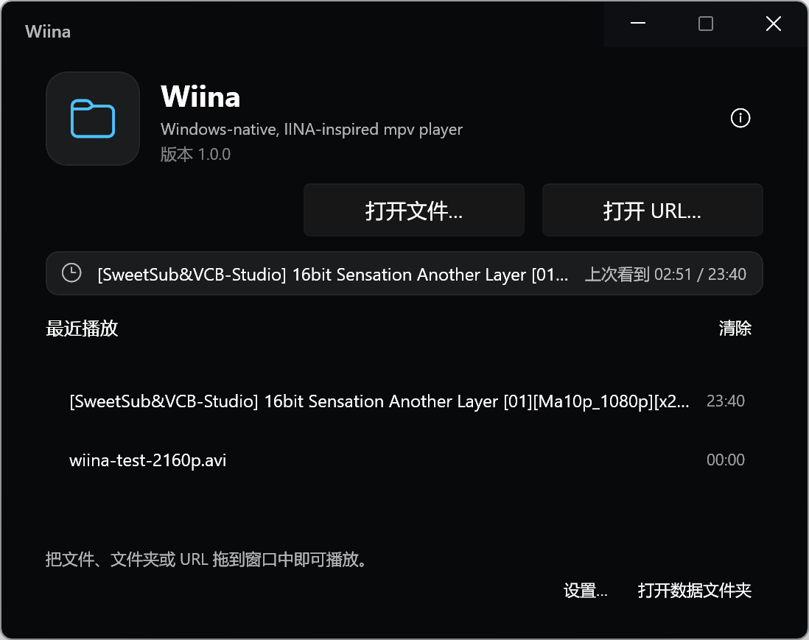
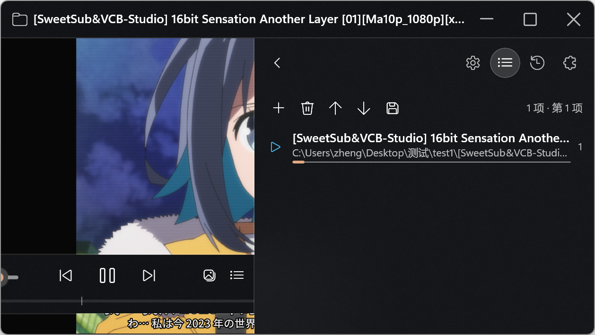
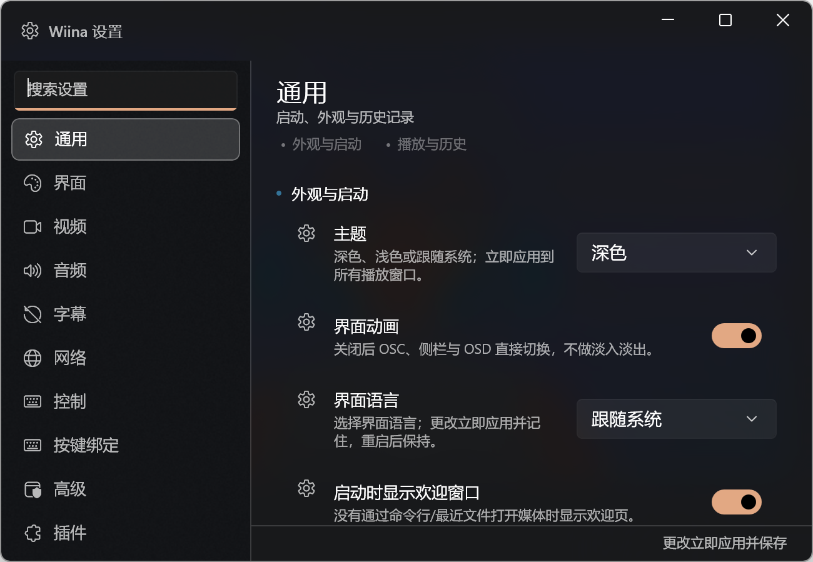

# v1 后续修复 — 启动、窗口、毛玻璃、字幕、外挂音频、快捷键

- **分支**：`fix/v1-polish`
- **基线**：`stage/11-release` / v1.0.0
- **日期**：2026-10-19

## 1. 启动 / 欢迎窗口

- 无媒体启动且启用欢迎页时，**只创建欢迎窗口**，不再在背后创建空的播放窗口。
- 在欢迎页打开文件/最近项后，播放器窗口以媒体路径创建，随后关闭欢迎窗口；避免
  “先建空窗口再 OpenExternalPaths” 的竞态（曾导致空窗口）。
- 直接拖动/选择媒体、命令行带路径时仍直接创建播放器窗口。
- 关闭欢迎窗口且没有播放器/设置窗口时退出进程；有设置窗口时保留。

## 2. 设置窗口

- 默认尺寸从 600×480 提高到 **760×600 DIP**（200% 缩放下约 1500×1190 物理像素）。
- 记住大小与位置：关闭时保存 DIP 尺寸 + 物理位置；重开时恢复并 clamp 到当前显示器工作区，
  避免越界。实测改为 1300×900 后重开恢复为 1300×899。

## 3. 毛玻璃 / WinUI 原生观感

- 标题栏：`AcrylicBrush`；系统 caption 按钮改为 **WinUI 自定义窗口按钮**（最小化/最大化/关闭），
  解决 DWM 在扩展标题栏右上角绘制纯色背景的问题；按钮使用 Fluent `Button` 样式。
- 浮动/底部 OSC：`OscAcrylicBrush`（深/浅/高对比度资源）；不再使用不透明 `PanelBrush`。
- 设置/欢迎窗口：`DesktopAcrylicBackdrop` + 半透明主题 tint，呈 Windows Terminal 风格的
  亚克力窗口；不再全黑底。
- 侧栏继续使用 `SidebarAcrylicBrush`；高对比度下回退系统颜色。
- 说明：视频 `SwapChainPanel` 之上的 per-element Acrylic 在部分合成路径上表现为
  “带色调的半透明”而非高斯模糊；真正的背景模糊需要额外的 Composition/Win2D 效果层，
  本次未引入新依赖。

## 4. IINA 风格智能字幕

- 新增 `SmartSubtitleFinder`：同名字幕（含点号后缀）自动发现，支持 `.ass/.ssa/.srt/.vtt/.sub/.idx`。
- 语言优先级：自动 → 简体（chs/sc/zh-Hans/zh-CN/chi/zho）→ 繁体 → 英语 → 日语；
  `.assfonts.ass` 作为兜底；`.idx` 必须有同名 `.sub`。
- `AutoLoadSmartSubtitles`（默认开）+ `PreferredSubtitleLanguage`；后台发现，`sub-add ... select`
  或复用 mpv 已自动加入的轨道（按 sid），不重复；显示 OSD “已自动加载字幕 · 文件名”。
- 实测：test1 自动加载 `.chs.assfonts.ass`；test2 自动加载 `sc.ass`，切换 `zh-Hant` 后选中 `tc.ass`。

## 5. 外挂音频

- 新增 `ExternalAudioFinder`；同名前缀 `.mka` 自动加载（默认开，仅 `.mka`，绝不加载无关音频）。
- Audio 菜单新增“加载外部音频…”选择器（`.mka/.ac3/.dts/.aac/.flac/.opus/.wav/.mp3/.m4a/.ogg`）。
- 使用 `audio-add <path> select`，失败回退 `audio-file`；OSD 提示。
- 实测 test2 `.mkv + .mka` 自动选中外挂 5.1 音轨。

## 6. IINA 风格快捷键 + 配置文件

- `KeyBindingProfiles`：Default / IINA / Custom；设置持久化。
- IINA 方案：Space 播放/暂停、←/→ ∓5s、Shift+←/→ ∓1s、↑/↓ 音量 ±5、F 全屏、Esc 退出全屏、
  M 静音、S 截图、O 打开、P 下一项、C 下一章、V 字幕显隐、[ / ] 速度减半/加倍、J/K 字幕延迟、
  Ctrl+←/→ 播放列表、Ctrl+PageUp/Down 章节、Ctrl+, 设置、Ctrl+Shift+P PiP、Ctrl+W 关闭窗口、Q 退出。
- Window 菜单实时切换方案并显示 ✓；按键编辑器读取当前方案的 Resolve，编辑后自动切到 Custom。

## 7. WinUI 原生化

- 标题栏按钮、设置/欢迎/关于/日志/检查器窗口、OSC 控件均使用 WinUI 控件与系统资源；
  窗口按钮不再依赖 DWM 的纯色 caption 背景。
- 保留 `TimelineControl`/`VolumeSlider` 的 Fluent Slider 组合（内部仍是原生 Slider），
  未做一次性的全部重写；后续可继续把剩余自定义组合替换为原生控件。

## 验证

- Debug/Release 构建：**0 warning / 0 error**
- Core 测试：**504 passed / 0 failed**（419 基线 + 85 新增）
- 桌面冒烟：
  - 无媒体只出现欢迎；欢迎打开媒体后仅播放器窗口；
  - 设置窗口 760×600，改尺寸/位置后重开恢复；
  - 标题栏/侧栏/设置亚克力；右上角无纯色 caption 块；
  - test1 自动字幕；test2 自动 `.mka`；
  - Window 菜单切换 IINA/Default，settings.json 持久化。

## 截图

### 欢迎（无播放器窗口）

### 播放器：亚克力标题栏 + 自定义窗口按钮 + 自动字幕

### 设置：亚克力、760×600 默认、尺寸记忆

## 已知问题

1. per-element Acrylic 在视频 swapchain 上可能只显示 tint，不是真正高斯模糊；需要额外
   Composition/Win2D 背景模糊层。
2. 设置/欢迎等辅助窗口仍使用系统 caption（未改成自定义按钮）；主播放器已改。
3. 智能字幕只查本地同名字幕，不做在线下载（Stage 10 仍跳过）；外挂音频自动只匹配 `.mka`。
4. 按键编辑器重置单项时使用 Default 方案默认值；如需按当前 IINA 方案重置，后续再加 profile-aware reset。
5. 设置窗口位置按物理像素保存，跨 DPI 显示器移动时大小会按新 DPI 重新解释。
