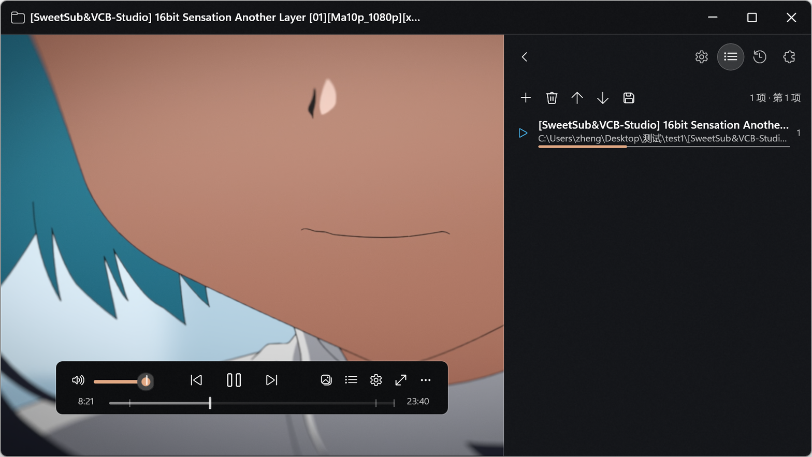
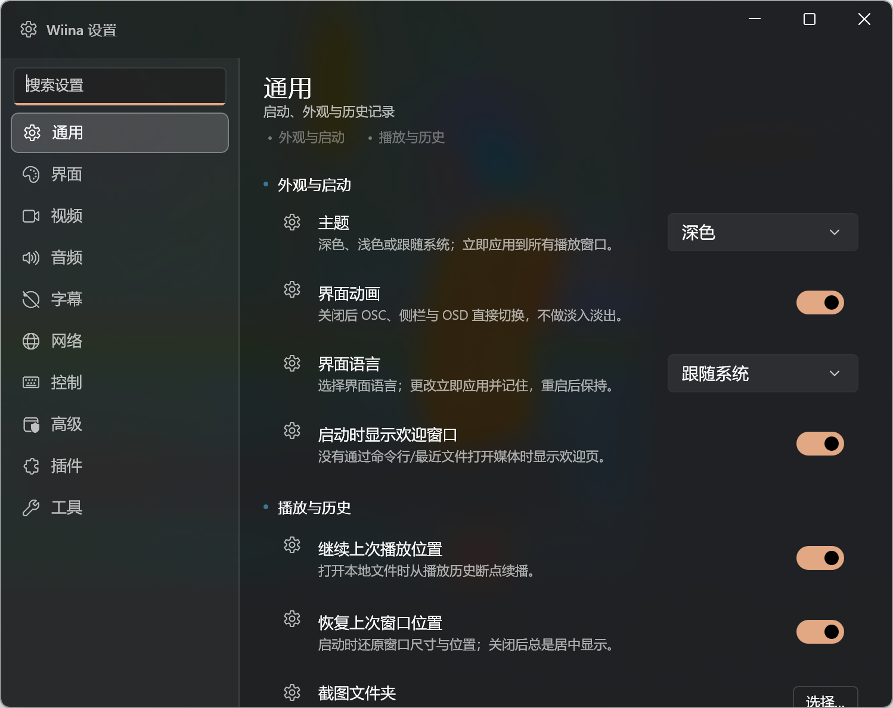
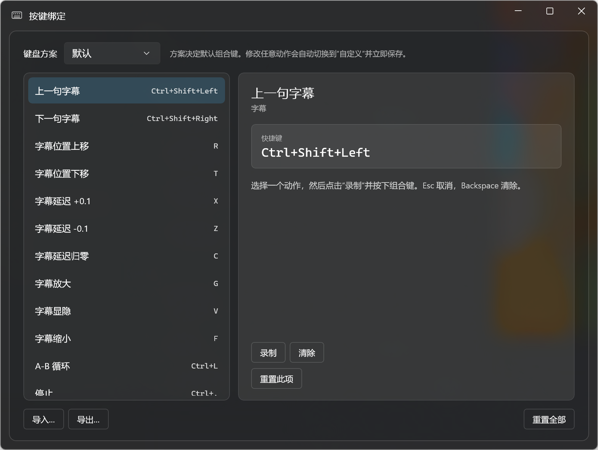

# v1 后续修复 2 — 模糊、窗口行为、音量、OSD、键位窗口、图标、发布

- **分支**：`fix/v1-polish-2`
- **基线**：`fix/v1-polish`
- **日期**：2026-10-19

## 1. 模糊 / 亚克力

- 标题栏、浮动/底部 OSC 使用更明显的 Acrylic 表面；窗口 tint 降低到 `#66`，让
  `DesktopAcrylicBackdrop` 的桌面模糊可见。
- 设置窗口左导航改为 `SettingsRailBrush` 半透明 wash，不再是割裂的实心深色块；
  设置页/卡片也使用透明 wash。
- **重要限制**：WinUI 3 现成合成 API 没有 `GaussianBlurEffect`，`AcrylicBrush` 叠在
  `SwapChainPanel`（视频）上时只呈平铺 tint，不能像右键菜单那样对实时视频做高斯模糊；
  要真正模糊视频，需要引入 Win2D/D3D 捕获依赖或独立合成层。本次按“最强可用 fallback”
  实现并记录在 `docs/architecture/0003-acrylic.md`。
- 设置/欢迎/键位窗口使用 `DesktopAcrylicBackdrop`，窗口级 DWM 模糊可见。

## 2. 窗口行为

- **锁宽高比所有边缘生效**：`WindowGeometry.ResizeWithAspect` 处理左/右/上/下边和四角，
  直边驱动自己的轴并调整另一维，角保持对角固定；最小 285×120 DIP，无抖动。
  桌面探针 8 条边 aspect 1.7775–1.7785。
- **初始窗口 = 视频分辨率**：第一次视频加载按 `video-params/dw/dh` 物理像素换算 DIP，
  cap 到工作区；超过屏幕时使用一半尺寸再按比例 fit。test1 1080p @200% 实测
  1920×1080 物理窗口；用户手动调整过窗口后不再自动覆盖。
- **时间/章节预览漂移**：`TimelineControl` 改为上报归一化比例，主窗口用 timeline 的
  `TransformToVisual` 锚定时间卡并 clamp；缩略图从时间卡实际位置定位；窗口/DPI 变化重算；
  拖动/离开取消旧请求。桌面 hover 未完全复现确认，建议手工在浮动/底部/顶部 OSC、
  100/150/200% DPI 下复核。

## 3. 音量

- OSC/标题栏/快速设置音量条显示并拖动上限为 **100%**。
- 键盘音量键可超过 100，最高由 `Settings → Audio → 音量上限`（100–200）控制；OSD 显示真实值。
- 从 >100 向下调时保持自然（130→125→…→100），滑块 thumb 在 100。
- MiniPlayer 的独立音量条仍是 0–130（不在本次 OSC 控件范围），后续可统一。

## 4. OSD 位置

- `OsdPosition` 扩展为 6 个：右下、左下、右上、左上、顶部居中、底部居中；
  保留旧 0–2 序列化值，新增 3–5。
- 设置/快速设置提供六项；OSD 安全边距 8 DIP。

## 5. 设置 / 键位窗口

- 移除设置底部的“已保存 + 时间”和“更改立即应用并保存”整条 footer；自动保存不变，
  保存失败改用对话框。
- 设置左侧导航隐藏“按键绑定”页；控制页在“键盘方案”后提供“编辑键位…”，
  打开独立的亚克力 `KeyBindingWindow`（880×660，可缩放，记忆尺寸）。
- 键位窗口支持方案切换、录制、Esc 取消、Backspace 清除、冲突替换、重置单项/全部、
  导入/导出；编辑即切 Custom 并保存。
- 修复了键位窗口首次打开的 XamlParseException（`Loc.Text` 在 KeyBindingsEditor 内联
  引起的 attached property 失败；改为代码设置三处静态标签并订阅语言变化）。

## 6. 欢迎窗口 / 图标 / 发布

- 欢迎页可缩放，最小 480×360，默认 560×440；记住大小/位置并 clamp 到工作区。
- 临时图标：白底 + 正放黄色三角形（`src/Wiina.App/Assets/wiina.ico` 9 帧 + PNG），
  已设置 `ApplicationIcon` 和 `AppWindow.SetIcon`。
- `scripts/release.ps1 -Version x.y.z`：同步 Directory.Build.props、Branding、PackageManifest、
  manifest、package.ps1 默认版本、Inno `#define`；生成版本化便携 zip；若存在 `iscc`
  则编译安装版，否则输出版本化 `.iss` 并警告；验证 assembly version，打印 SHA256。
  - 本机未安装 Inno Setup，安装版编译路径只做了版本检查，未产出 exe。
  - 测试 1.0.1 后已恢复 1.0.0（Stage11ReleaseTests 固定 1.0.0）。

## 7. 构建/测试

- Release 构建：**0 warning / 0 error**
- Core 测试：**590 passed / 0 failed**（504 基线 + 86 新增；含页面/窗口/音量/OSD/版本测试）
- 新增：`WindowGeometryTests` 16、`WindowSizingTests` 18、`VolumeMappingTests` 34、
  `OsdPositionsTests` 17，以及 release/version 测试。

## 截图

### 播放器：亚克力标题栏 + 小尺寸窗口按钮 + 自动字幕

### 设置：透明导航 rail、无底部 footer、清晰窗口级模糊

### 独立键位窗口（亚克力）

### 临时图标：白底 + 正放黄三角

## 已知问题

1. 实时视频上的高斯背景模糊在当前 WinUI 3 依赖下不可用；现为桌面窗口模糊 + 视频上 tint
   fallback。需要 Win2D/D3D 捕获层才能做到右键菜单级视频模糊。
2. 时间/章节预览修复未能在桌面 hover 中完全复现验证；代码锚定逻辑已改，建议手工复核。
3. Inno Setup 未安装，安装版未实际编译；便携版已可用。
4. MiniPlayer 独立音量条仍可显示 >100（OSC/标题栏/快速设置已限制）。
5. 键位窗口/设置/欢迎仍使用系统 caption（主播放器用自定义 WinUI 按钮）。
