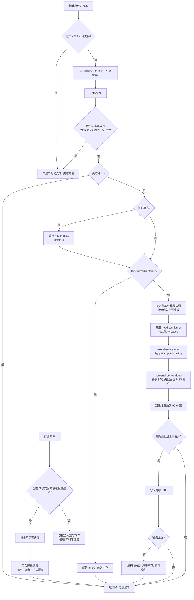

# 缩略图（进度条悬停预览）完整逻辑

本文是 Wiina 时间轴缩略图的**实现参考文档**：两种生成模式、截取链路、三级缓存（内存 / 磁盘 / 预生成）、每个设置开关到底改变什么、性能数据与已知限制。内容按 `feat/v1.3.6` 当前树逐项核对，所有结论均给出行号；数字与实测记录见 [docs/performance.md](../performance.md) 与各版本验收页。

> 版本注记：本文按 **1.3.6** 当前树（`feat/v1.3.6`）核对，含 1.3.6 新增的“生成完成前允许预览”开关（`video.thumbnail-preview-while-generating`，默认关，见 §8.1）；1.3.5 的即时预览模式与更早的行为保持不变。

---

## 1. 一句话结论

- 缩略图由**第二个、无窗口的 libmpv 实例**按需解码，主播放器完全不参与；UI 线程不做文件 IO、不做缩放。
- 结果分三级：**内存 LRU**（当前视频全部时间桶）→ **磁盘 JPEG 缓存**（跨进程、可清理）→ **后台预生成**（把整片逐桶灌进上面两级）。
- 只有**一个**提取工作线程：同一时刻最多一个 libmpv seek 在飞；悬停请求排在预生成之前，预生成在用户交互后会让路。
- 两种模式：**预生成（默认）** 与**即时预览**；另有**慢速模式**、**硬件加速**、**磁盘上限**、**总开关**、**生成完成前是否允许预览**与**清除缓存**。

---

## 2. 相关设置

| 设置 id | 位置 | 控件 | 默认 | 范围 / 取值 | 作用 |
| --- | --- | --- | --- | --- | --- |
| `video.thumbnail-preview` | 视频 → 缩略图 | 开关 | **开** | 开 / 关 | 总开关：关闭后不建 headless mpv、不预生成、不悬停提取、不写盘（`SettingsCatalog.cs:242-247`，`AppSettings.cs:58`） |
| `video.thumbnail-mode` | 视频 → 缩略图 | 下拉 | **预生成（推荐）** | 预生成 / 即时预览 | 决定是否遍历全片、是否读写磁盘（`SettingsCatalog.cs:248-256`，`ThumbnailMode` 枚举） |
| `video.thumbnail-hover-delay` | 视频 → 缩略图 | 数字 | **250 ms** | 0–2000，步进 50 | 仅即时预览：指针停留多久后才解码（`SettingsCatalog.cs:257-266`，`AppSettings.cs:98`） |
| `video.thumbnail-preview-while-generating` | 视频 → 缩略图 | 开关 | **关** | 开 / 关 | 预生成模式下整片未生成完时是否允许悬停预览；关 = 悬停不发请求（返回 null、不读盘、不按需解码），对齐 IINA `thumbnailsReady`；即时模式恒允许（`SettingsCatalog.cs:267-273`，`AppSettings.cs:107`，`ThumbnailPolicy.cs:59-77`） |
| `video.thumbnail-width` | 视频 → 缩略图 | 数字 | **160 DIP** | 80–320 DIP | 悬停浮层宽度；高度按视频比例算（`SettingsCatalog.cs:274-280`，`AppSettings.cs:60`） |
| `video.thumbnail-bucket` | 视频 → 缩略图 | 数字 | **5 秒** | 1–30 秒 | 时间桶大小；越大越省内存、精度越低（`SettingsCatalog.cs:281-287`，`AppSettings.cs:62`） |
| `video.thumbnail-cache-mb` | 视频 → 缩略图 | 数字 | **512 MB** | 0–4096，步进 64 | 磁盘缓存字节上限；0 关闭磁盘缓存（`SettingsCatalog.cs:288-295`，`AppSettings.cs:72` 中 `ThumbnailCacheMegabytes`） |
| `video.thumbnail-slow` | 视频 → 缩略图 | 开关 | **关** | 开 / 关 | 慢速模式：不预生成、单线程 `BelowNormal`、每帧后冷却 250 ms（`SettingsCatalog.cs:296-302`） |
| `video.thumbnail-acceleration` | 视频 → 缩略图 | 下拉 | **自动（推荐）** | 自动 / 仅 CPU | 自动 = `hwdec=auto-safe`；仅 CPU = `hwdec=no`（`SettingsCatalog.cs:303-311`，`ThumbnailAcceleration.cs`） |
| `video.thumbnail-hint` | 视频 → 缩略图 | 说明 | — | — | 提示低配设备可开慢速模式（`SettingsCatalog.cs:312-317`） |
| `video.thumbnail-cache-clear` | 视频 → 缩略图 | 按钮 | — | — | 删除磁盘 + 内存缓存并报告释放空间（`SettingsCatalog.cs:318-325`） |
| `advanced.clear-thumbnails` | 高级 → 维护 | 按钮 | — | — | 同上，第二入口（`SettingsCatalog.cs:936-943`） |

补充：

- **内存容量没有 UI 行**。1.3.2 起 `video.thumbnail-cache` 行被删除，`AppSettings.ThumbnailCacheCount`（默认 60，`AppSettings.cs:69`）只作为**短片的容量下限**保留。
- 除**缩略图间隔（桶大小）**外，缩略图设置都**即时生效**，不需要重启（`MainWindow.Settings.cs:140-215`）；桶大小在服务构造时读取（`MainWindow.Osd.cs:578`），因此要等下次创建服务（重启应用，或关闭再打开预览）才生效。解码路径切换会在**下一次提取时重建 headless player**。
- **`video.thumbnail-preview-while-generating` 只影响“预生成进行中”的悬停**：关闭（默认）时，整片未生成完之前悬停返回 `null`（不读磁盘、不排队解码、不显示加载态）；打开则允许边生成边预览。即时模式没有整片遍历，恒允许（`ThumbnailPolicy.cs:59-77`、`ThumbnailService.cs:478-499`）。

---

## 3. 两种模式

### 3.1 预生成（PreGenerate，默认）

1. 打开文件、拿到 `duration` 后，`MainWindow.StartThumbnailPreGeneration()`（`MainWindow.Osd.cs:598-653`）先按全片长度给内存缓存定容，再启动后台遍历。
2. 遍历从桶 0 到 `floor(duration / bucket)`：内存命中 → 跳过；磁盘命中 → 读回并放进内存；否则排一个**后台**提取任务（`ThumbnailService.StartPreGeneration` `:554-601`、`PreGenerateAsync` `:642-706`）。
3. 提取结果写内存缓存，并在允许时写磁盘（`ExtractAsync` `:885-953`）。
4. 悬停时绝大多数位置已是内存命中，因此“几乎即时”（热悬停约 4 ms，见 §10）。
5. 悬停先过“生成完成前允许预览”闸门：遍历未完成且开关关闭（默认）→ 直接返回 `null`，不读盘、不排队、不显示加载态；打开 → 允许边生成边预览。后台遍历任务本身不被拦（`background: true` 跳过闸门，`ThumbnailService.cs:478-499`）。

### 3.2 即时预览（Instant）

- 不遍历全片、**不读也不写磁盘缓存**（`ThumbnailPolicy.AllowsDiskCache` 返回 false，`:44-45`）；打开文件时的定容入口会跳过定容与预生成（`StartThumbnailPreGeneration` 在 Instant 下直接 return，`MainWindow.Osd.cs:629-632`），但**首次悬停**时 `GetAsync` 会为当前源调用 `SetSource`，仍把内存容量按全片设上限（只设上限、不预填充；`ThumbnailService.cs:433-436`）。这与窗口侧“即时模式不定容”的注释不一致，见 §11。
- 悬停后先等 `video.thumbnail-hover-delay`（默认 250 ms，`GetAsync` `:443-470`）；指针移走会取消等待，所以扫过整条进度条最多只解码**最后停留**的位置。
- 同一时间只保留一个待处理悬停任务：新位置到来时清掉队列里的旧悬停任务（`CancelPendingHoverJobsLocked` `:378-395`）；已在飞的任务会跑完，其结果仍进内存缓存。
- 命中内存缓存时立即返回，所以“回看刚看过的位置”在即时模式下也很便宜。
- 服务本身在退出即时模式时不会主动重启预生成；但设置窗口的实时应用路径会为当前文件立刻重新启动遍历（`MainWindow.Settings.cs:166-179`）。

---

## 4. 截取链路

```
悬停进度条
  └─ MainWindow.ShowTimePreview()  → ThumbnailPeek.ShowLoading()（转圈）
       └─ RequestThumbnailAsync(seconds)          MainWindow.Osd.cs:499
            ├─ 总开关关 / 非本地文件 / 无视频宽度 → 直接隐藏并返回
            ├─ 取消上一个悬停 CTS，建新 CTS      :510-513
            └─ ThumbnailService.GetAsync(path, seconds, duration, height=90, token)
                 ├─ 内存命中 → 直接返回                      ThumbnailService.cs:438
                 ├─ 即时模式 → 等待 hover delay（可取消）     :443-470
                 ├─ 磁盘允许且命中 → 解码 JPEG、放内存、返回   :476-496
                 └─ 否则排队 → 单工作线程 ExtractAsync        :509-547 / :749-823
                      ├─ EnsurePlayer()：headless libmpv      :955-998
                      ├─ LoadFileAsync()：loadfile + pause    :1000-1028
                      ├─ SeekAsync()：seek absolute exact + 轮询 time-pos/seeking  :1030-1049
                      ├─ Capture()：screenshot-raw "video"，最多 3 次，间隔 80 ms  :1051-1075
                      ├─ 失败回退 CaptureToFileAsync()：screenshot-to-file + PNG 解码  :1077-1129
                      ├─ Scale()：双线性缩放到目标高度（BGRA8，顶朝下）  :1308-1399
                      ├─ 内存 Put()（源路径仍匹配时）      :919-924
                      └─ 允许时 WriteDiskAsync()：JPEG + 索引  :936-942 / :1170-1197
```

要点：

- headless 实例以 `Start(1280, 720, headless: true, hwdec: …)` 启动（`EnsurePlayer` `:955-998`）；`hwdec` 取 `auto-safe` 或 `no`。
- headless 的 mpv 选项在 `src/Wiina.Mpv/MpvPlayer.cs`：打开 `sub-visibility=no`（`:181`），并设 `sub-auto=no` / `sid=no` / `secondary-sid=no` / `osd-bar=no`（`:191-194`）。
- 截图固定用 `ScreenshotRaw("video")`（`MpvPlayer.cs:525`，`ThumbnailService.cs:1060`）——`video` 标志保证**不含字幕与 OSD**，这是 1.3.5 修复“缩略图带字幕”的关键。
- 缩放是自写的双线性采样（`Scale` `:1308`）：目标高度 `Clamp(targetHeight, 24, 240)`，宽度按源宽高比并 `Clamp(…, 32, 480)`；支持 BGRA/BGR0/RGBA/RGB0、负 stride（bottom-up）。
- 提取完成后若总开关已关，或源已换片，帧**不会**写入缓存（`:916-924`）；磁盘写入同样要求总开关仍开（`:936-942`）。

---

## 5. 并发与队列

- 单工作线程：`EnsureWorkerLocked()` 用 `TaskCreationOptions.LongRunning` 起一条专用线程（`:710-724`），线程内串行处理任务；同一时刻只有一个 libmpv seek 在飞。
- 队列优先级：**悬停（前台）> 预生成（后台）**；同优先级按桶号升序（`Compare` `:879-883`）。悬停命中一个已在排队的后台任务时，该任务会被“升级”为前台并重排（`GetOrCreateJob` `:509-547`）。
- 后台任务避让：若最近 1 秒内有用户交互，后台任务先 `Sleep(120 ms)`，避免拖拽预览被后台 seek 抢占（`WorkerLoop` `:786-790`）。
- 慢速模式下每帧提取后 `Thread.Sleep(250)`（`SlowModeCooldownMilliseconds`，`ThumbnailPolicy.cs:16`；`WorkerLoop` `:811-816`），且线程优先级降到 `BelowNormal`（`:731-747`）。
- 任务去重键 = 路径 + 秒 + 目标高度（`JobId` `:1300-1305`），同一位置的并发请求共享一个任务。
- 总开关关闭时：清空排队任务（每个等待者得到 `null`）、停止预生成、且工作线程空闲后释放 headless player（`PreviewEnabled` `:205-238`、`CompleteQueuedJobsLocked` `:249-261`、`DisposePlayerWhenPreviewOff` `:831-844`）。

---

## 6. 内存缓存

- 类型：`ThumbnailCache<ThumbnailFrame>`（`src/Wiina.Core/Caching/ThumbnailCache.cs`），按时间桶做 **LRU**：`BucketFor(seconds, bucket)` = `floor(seconds / bucket)`（`:59-72`），命中即提到队首（`:76-92`），超容量从队尾淘汰并回调释放（`:95-135`）。
- 容量：`ceil(duration / bucket) + 2`，且不低于“缓存下限”（默认 60）；时长未知或 ≤0 时退回下限（`ThumbnailCacheSizing.FramesForDuration` `:26-44`，`BucketPadding = 2` `:15`）。
- 每帧字节数：宽 × 高 × 4（BGRA8，`FrameBytes` `:47-48`）。实际提取高度 90 px、按 16:9 约 160×90 → **57,600 B ≈ 57.6 KB/桶**。
- 估量：约 **41 MB/小时**；24 分钟 ≈ 287 帧 ≈ **15.8 MB**；2 小时 ≈ 1442 帧 ≈ **83 MB**。
- 换片即清空：`SetSource` 检测到路径变化先 `Clear()`，再按新片时长 `Resize()`（`ThumbnailService.cs:120-150`）；`ClearSource()` 回到下限（`:157`）。
- 关闭预览、切慢速模式、磁盘预算归零或切到即时预览时会调用 `StopThumbnailPreGeneration()`，它先 `ClearSource()` 把内存缩回下限，再停止后台遍历（`MainWindow.Osd.cs:693-696`；调用点 `MainWindow.Settings.cs:150-153`、`:166-179`、`:186-199`、`:204-212`）。

---

## 7. 磁盘缓存

- 位置：`%LOCALAPPDATA%\Wiina\thumbnails\v2\`（根目录由 `App.DataFolder` + `thumbnails` 传入，`MainWindow.Osd.cs:580`；版本子目录 `v2` 由 `ThumbnailDiskCache` 拼接，`ThumbnailDiskCache.cs:68`）。
- 目录结构：
  - `index.json`：全部条目（相对路径、源身份、桶、宽高、字节、最后访问时间）。
  - `version.json`：格式版本（当前 `FormatVersion = 2`，`:39`）。
  - `<sourceKey>/<bucket>.jpg`：每个源一个目录，每个时间桶一张 JPEG（`:630-633`）。
- 键：`SHA-256("wiina-thumbs" + 版本 + 小写规范路径 + 文件大小 + mtime + 时长 + 桶 + 高度)` 取前 16 字节 → 32 位小写十六进制（`ComputeSourceKey` `:110-126`）；路径规范化会 `GetFullPath` + 去尾分隔符 + 转小写（`:128-149`）。任一字段变化都产生新键，旧帧不会被错用。
- 一致性：读取时校验源大小 / mtime / 时长 / 桶 / 高度 / 路径，不匹配就**整源失效**（`Matches` `:614-622`、`InvalidateSourceLocked` `:580-599`）；文件已不存在或字节数不符则删条目（`:162-210`）。
- 写入：先写 `*.tmp` 再 `File.Move(overwrite: true)` 原子替换，然后更新索引（同样临时文件 + 移动，`Put` `:234-274`、`FlushLocked` `:518-540`）。写失败只记日志，不影响播放。
- 容量：按**字节** LRU 淘汰（`SetLimitBytes` `:152-160`、`TrimLocked` `:542-578`），上限来自 `video.thumbnail-cache-mb`（默认 512 MB，0 = 关闭）。
- 损坏恢复：索引缺失/解析失败/版本不符 → 清空当前版本目录重建（`EnsureLoaded` `:382-479`）；旧格式根目录（`v*`）在版本升位时删除（`DeleteStaleVersionRoots` `:481-499`）；单条读失败只删该条。
- 清理入口：设置里的“清除缩略图缓存”（磁盘 + 内存，并报告释放字节，`MainWindow.Settings.cs:47-62`、`ClearDiskCache` `:640`），或直接删除目录（下次启动自建）。

---

## 8. 开关 → 行为

| 组合 | 预生成 | 悬停提取 | 读磁盘 | 写磁盘 | 全片内存定容 | headless mpv |
| --- | --- | --- | --- | --- | --- | --- |
| 总开关**关** | 否 | 否 | 否 | 否 | 否（清空） | 不创建，空闲后释放 |
| 预生成 + 慢速**关** + 磁盘 > 0 | **是** | 是（遍历完成后；开关可放宽） | 是 | 是 | 是 | 按需创建 |
| 预生成 + 慢速**开** | 否 | 是（单线程冷却） | 是 | 是 | 是 | 按需创建 |
| 预生成 + 磁盘 **0** | 否（`AllowsPreGeneration` 要求 >0） | 是 | 否 | 否 | 是 | 按需创建 |
| **即时预览**（任意慢速/磁盘） | 否 | 是（等 hover delay，只留一个待处理） | **否** | **否** | 窗口侧跳过；首次悬停仍按全片设容量上限、不预填充 | 按需创建 |
| 非本地文件（URL / 流 / 文件不存在） | 否 | 否 | 否 | 否 | 否 | 不创建 |

实现依据：`ThumbnailPolicy.cs:29-37`（预生成门槛）、`:44-45`（磁盘门槛）、`:56-57`（悬停延迟仅即时）；`ThumbnailService.cs:418-424`、`:561-601`、`:629-637`。

预生成进行中的闸门由 `ThumbnailPreGenerationTracker`（`src/Wiina.Core/Caching/ThumbnailPreGenerationTracker.cs`：按源路径记 total/completed，换片 `Begin` 重置，失败桶也 `MarkCompleted`，不会遍历的分支 `MarkComplete`）+ `ThumbnailPolicy.AllowsHoverPreview`（`:70-77`）决定。

### 8.1 “生成完成前允许预览”（`video.thumbnail-preview-while-generating`，默认关）

- 位置：视频 → 缩略图，紧跟“缩略图悬停延迟”（`SettingsCatalog.cs:267-273`）；`AppSettings.ThumbnailPreviewWhileGenerating` 默认 `false`（`AppSettings.cs:107`）。英文覆盖为 “Preview while generating”（`SettingsLocalization.cs`）。
- 语义（预生成模式）：
  - **关（默认，与 IINA `thumbnailsReady` 一致）**：整片缩略图还没生成完之前，悬停进度条**不显示预览**，也不读磁盘缓存、不排队解码、不显示加载态；遍历完成后自动恢复预览。
  - **开**：允许边生成边预览；未命中的桶按悬停优先级排队提取，生成进度继续在后台推进。
  - **即时模式恒允许**，不受此开关影响（没有整片遍历，`ThumbnailPolicy.AllowsHoverPreview` 先判 `mode == Instant`）。
- 判定链：`ThumbnailService.GetAsync` 在后台标记为 `false` 的请求上调用 `ThumbnailPolicy.AllowsHoverPreview(Mode, _previewWhileGenerating, _pregen.IsPendingFor(path))`，任一为真才继续（`ThumbnailService.cs:478-499`）；后台预生成请求传 `background: true`，**永不被拦**。
- 进度来源：`ThumbnailPreGenerationTracker`（`src/Wiina.Core/Caching/ThumbnailPreGenerationTracker.cs`）按源路径记录 `TotalBuckets`/`CompletedBuckets`：`Begin` 在 `StartPreGeneration` 开始时重置；每个桶无论内存命中（`:739-743`）、磁盘命中（`:746-755`）还是提取完成/失败（`:758-772`）都 `MarkCompleted`；慢速模式、磁盘关闭、非本地文件、空时长等不会遍历的分支直接 `MarkComplete`（`:655-671`），因此不会把预览永久挡死。
- 即时生效：设置变更走 `MainWindow.Settings.cs:183-189` → `ThumbnailService.SetPreviewWhileGenerating`；下一次悬停即按新值判定（无需重启、无需重建服务）。
- 边界：对一个**从未开始过遍历的源**，`IsPendingFor` 返回 false（视为不等待），所以关闭开关也不会挡住“原本就没有预生成任务”的悬停路径。

---

## 9. 生效时机与生命周期

| 动作 | 生效方式 |
| --- | --- |
| 改总开关 | 立即：停预生成、内存缩回下限、清空排队、隐藏浮层；重新打开时若已打开文件则重新启动预生成（`MainWindow.Settings.cs:147-164`） |
| 改模式 | 立即：切即时停预生成并丢弃排队悬停；切回预生成对当前文件重启遍历（`:162-176`） |
| 改悬停延迟 | 立即（下一次悬停）(`:177-182`) |
| 改“生成完成前允许预览” | 立即（下一次悬停）`SetPreviewWhileGenerating`（`:183-189`） |
| 改慢速模式 | 立即：改线程优先级、停/启预生成（`:190-203`） |
| 改硬件加速 | 下一次提取重建 headless player，缓存保留（`:204-209`） |
| 改磁盘上限 | 立即 `SetLimitBytes` 触发 LRU 淘汰；0 时停预生成（`:210-222`） |
| 改缩略图宽度 | 下一次悬停生效（浮层尺寸直接读设置，`MainWindow.xaml.cs:1302`） |
| 改缩略图间隔（桶大小） | 服务构造时读取（`MainWindow.Osd.cs:578`），需重建服务/重启才生效；换桶后内存与磁盘都按新键重新生成，旧条目按 LRU 自然淘汰 |
| 换片 | 清内存、按新时长定容；预生成对新片重启（`SetSource` / `StartThumbnailPreGeneration`） |
| 关闭应用 | 工作线程结束、headless player 释放、磁盘索引 flush（`Dispose` `:1434-1462`） |

---

## 10. 性能数据（实测记录）

数据来自 [docs/performance.md](../performance.md) 与 [v1.3.1 验收](../acceptance/v1.3.1.md)、[v1.3.2 验收](../acceptance/v1.3.2.md)、[v1.3.5 验收](../acceptance/v1.3.5.md)：

| 项目 | 数值 | 备注 |
| --- | --- | --- |
| 预生成（冷） | 285 个桶 **14.1–14.9 s** | 首次打开、磁盘无缓存 |
| 预生成（热） | 285 个桶 **0.3 s** | 全部命中磁盘缓存 |
| 悬停（冷） | **73 ms** | 需要解码 |
| 悬停（热） | **4 ms** | 内存命中 |
| 单帧解码（自动 / GPU） | **29 ms wall，15.6 ms CPU** | `hwdec=auto-safe` |
| 单帧解码（仅 CPU） | **104 ms wall，461 ms CPU** | `hwdec=no` |
| 磁盘占用 | 285 帧 **1.70 MB ≈ 6 KB/帧**（JPEG） | 90 px 高 |
| 内存占用 | 约 **57.6 KB/桶**，**≈41 MB/小时**；24 min ≈ **15.8 MB**；2 h ≈ **83 MB** | 160×90 BGRA8 |

---

## 11. 已知限制

- **只支持本地文件**：`IsLocalFile` 要求路径存在且带扩展名（`ThumbnailService.cs:1408-1417`），URL / 网络流 / UNC（不存在时）直接返回 `null`，浮层只剩时间文字。
- **超长视频**：内存随片长线性增长（≈41 MB/h），磁盘也随桶数增长；2 小时约 83 MB 内存，属于设计取舍。
- **每个视频一个磁盘键**：路径、大小、mtime、时长、桶、高度任一变化都会产生新键；旧条目要等 LRU 或手动清理，不会自动迁移。
- **单工作线程**：预生成与悬停共用一条线程；低配设备上预生成会与播放争 CPU（1.3.6 提供慢速模式与即时模式缓解）。
- **解码路径切换**：从“仅 CPU”切回“自动”会在下一次提取时重建 headless player（一次性的启动开销）。
- **慢速模式仍会写磁盘**：它只关掉全片预生成并降低线程优先级/加冷却，不关闭磁盘缓存。
- **悬停浮层有加载态**：内存/磁盘都未命中时先显示转圈（`ThumbnailPeek.ShowLoading`，`ThumbnailPeek.xaml.cs:17-26`），冷启动时可能闪现。
- **即时模式的内存容量上限仍按全片设**：窗口注释所说的“不做全片定容”指不预生成、不预填充（`MainWindow.Osd.cs:627-634`）；首次悬停时 `GetAsync` 会调用 `SetSource`，把**容量上限**设为全片桶数（`ThumbnailService.cs:433-436`），但缓存只为实际请求过的桶分配槽位，因此不会瞬间占用整片内存，也不会自动填满。
- **字幕/OSD 已排除**：`screenshot-raw video` + headless 的 `sid=no` 等选项共同保证；若未来改动截图标志，需要回归“缩略图不带字幕”。

---

## 12. 流程图



---

## 13. 代码索引

| 关注点 | 文件:行 |
| --- | --- |
| 模式枚举（预生成 / 即时） | `src/Wiina.Core/Settings/ThumbnailMode.cs:14,17` |
| 加速枚举（自动 / 仅 CPU） | `src/Wiina.Core/Settings/ThumbnailAcceleration.cs:9` |
| 策略常量与门槛 | `src/Wiina.Core/State/ThumbnailPolicy.cs:16-77` |
| 预生成进度跟踪（生成完成前闸门） | `src/Wiina.Core/Caching/ThumbnailPreGenerationTracker.cs:18-168` |
| 内存缓存容量公式 | `src/Wiina.Core/Caching/ThumbnailCacheSizing.cs:26-52` |
| 内存 LRU | `src/Wiina.Core/Caching/ThumbnailCache.cs:18-205` |
| 磁盘缓存（键 / 原子写 / LRU / 恢复） | `src/Wiina.Core/Caching/ThumbnailDiskCache.cs:39-699` |
| 服务门面（模式 / 延迟 / 加速 / 总开关 / 生成完成前预览） | `src/Wiina.App/Services/ThumbnailService.cs:120-371` |
| 悬停请求与预生成入口（含 `GetAsync` 闸门 :478-499） | `src/Wiina.App/Services/ThumbnailService.cs:410-706` |
| 队列 / 工作线程 / 优先级 | `src/Wiina.App/Services/ThumbnailService.cs:509-883` |
| 截取 / 缩放 / JPEG 编解码 | `src/Wiina.App/Services/ThumbnailService.cs:885-1406` |
| 设置行 | `src/Wiina.Core/Settings/SettingsCatalog.cs:242-325`、`:936-943` |
| 设置默认值 | `src/Wiina.Core/Settings/AppSettings.cs:58-107` |
| 设置即时生效 | `src/Wiina.App/MainWindow.Settings.cs:140-231` |
| 悬停浮层 | `src/Wiina.App/Controls/ThumbnailPeek.xaml.cs:15-53` |
| 悬停触达 / 请求 | `src/Wiina.App/MainWindow.xaml.cs:1300-1310`、`src/Wiina.App/MainWindow.Osd.cs:499-570` |
| 预生成调度与释放 | `src/Wiina.App/MainWindow.Osd.cs:572-653`、`:693-694`、`:755-756` |
| 清除缓存动作 | `src/Wiina.App/MainWindow.Settings.cs:47-62` |
| headless 选项 / screenshot-raw | `src/Wiina.Mpv/MpvPlayer.cs:181,191-194,525` |

---

## 14. 相关文档

- [缩略图性能优化可行性（v1.3.7，仅报告）](../reports/thumbnails-optimization-1.3.7.md)

- [性能测量](../performance.md) — 缩略图各档耗时与占用。
- [1.3.1 验收](../acceptance/v1.3.1.md) — GPU 解码与整片内存缓存。
- [1.3.2 验收](../acceptance/v1.3.2.md) — 关闭预览即零生成、删除缓存数量行。
- [1.3.5 验收](../acceptance/v1.3.5.md) — 即时预览模式与悬停延迟。
- [1.3.6 验收](../acceptance/v1.3.6.md) — 毛玻璃满幅、生成完成前允许预览、占位可读性。
- [IINA 缩略图研究](iina-thumbnails.md) — IINA 的预生成/磁盘缓存对照。
- [设置布局快照](settings-layout.md) — 视频 → 缩略图 的全部行。
